# The Propagator

**South Orange Amateur Radio Association | October 2026**

<!-- Delete unused optional sections. The Upcoming SOARA Events calendar stays
FIRST so it lands on the front page every month (this month + next month). Keep
other time-sensitive club news near the front. The SOARA Information section is a
standard evergreen page at the back that renders as a compact two-column layout. -->

## Upcoming SOARA Events

<!-- FRONT-PAGE at-a-glance calendar. Prepared with calendar.md. Always show this
month and next month. Use unambiguous dates (weekday + date) and verify every
date, time, and location against the club calendar before publication. -->

### This Month — October 2026

| Date | Time | Event | Location |
|---|---|---|---|
| Saturday, October 17 | 9:00 AM–noon | SOARA Elmer Saturday | Gilleran Park |
| Monday, October 19 | 6:00 PM | Ham Radio License Exams | Murray Center |
| Monday, October 19 | 6:30 PM | Membership Meeting — Live RADE Demo | Murray Center |
| Monday, October 26 | 7:00 PM | Board Meeting | Murray Center |

### Next Month — November 2026

| Date | Time | Event | Location |
|---|---|---|---|
| Saturday, November 14 | 9:00 AM–noon | SOARA Elmer Saturday | Gilleran Park |
| Monday, November 16 | 6:00 PM | Ham Radio License Exams | Murray Center |
| Monday, November 16 | 6:30 PM | Membership Meeting | Murray Center |
| Monday, November 23 | 7:00 PM | Board Meeting | Murray Center |
| November (date TBD) | TBD | SOARA Live Auction | See soara.org |

*Dates, locations, and times are subject to change. Check the
[SOARA website](https://www.soara.org) before attending.*

## President's Message

October is the month when SOARA starts a new fiscal year. We end this year with a little over $25,000 in the bank, which is more than enough for us to continue operations for another year. However, our bank account is about $3,000 less than the end of last year. I mention this not to alarm any member, but just as a reminder that since SOARA's primary source of income is member dues, we really need every renewal and also more new members. We had a number of hams and prospective hams join us at Field Day and in the months following, many from the Mesa Crest Repeater Club, which is a GMRS repeater system. We appreciate and welcome our new members.

At present, SOARA does not have a Membership Director. I have taken on this role temporarily, but we really need a person who can dedicate themselves to the task of maintaining our roster and getting new members added to the various systems. This role requires some knowledge of Linux because our system is driven by various shell scripts and PHP code. If you think you might be interested in helping, please contact me at w6edt@soara.org.

In the interim, I am acting Membership Director and will be preparing renewal notices to be emailed to all members soon. When you receive your invoice, it would be helpful if you could pay the amount listed as soon as possible at [https://amp.soara.org/btp/run/](https://amp.soara.org/btp/run/). For most members this will be $50 for the primary member and $25 for an additional family member. However, your amount may be different if you have a credit for some reason from a prior year. Please pay only the amount shown on the invoice. If you have any questions, please email me.

SOARA has an auction coming up in November. It is a good chance to pick up some interesting equipment and possibly sell some of your treasures. Details can be found at [https://www.soara.org/club-calendar/live-auction/](https://www.soara.org/club-calendar/live-auction/). We have had some donations made directly to the club which will help cover some of our annual expenses. SOARA charges a 10% commission if you want to sell some of your personal items and make some money to buy more ham gear.

While talking to Ed Barnes, WA6ED, on the morning drive-time net he said something which I found very inspirational. He said "A ham radio license is a license for lifelong learning." I truly believe that this is one of the great benefits of our hobby. Learning keeps us interested in life, especially as we age and can't do some of the more strenuous activities we did earlier in life. But this benefit is not limited to those of us who are on the far side of 70 years, it is also a way for those among us who are parents to children (or even grandparents) to inspire curious children who are often very motivated to learn new things. The wide variety of things you can do with a ham radio license that cannot be done otherwise should allow anyone of any age to ask themselves "What can I learn today?" I hope you will consider trying something new related to ham radio.

73,

Dale Tyler, W6EDT

## Membership Meeting

### October Membership Meeting: Live RADE Demo

Join us Monday, October 19, at 6:30 PM at the Murray Center for our monthly membership meeting. This month we're planning a live demonstration of RADE, which carries digital voice over HF, so come see it on the air. License exams start at 6:00 PM, just before the meeting.

Watch the SOARA website for the latest meeting details.

## SOARA Saturday Report

Our next SOARA Saturday will be October 17, 2026, at Gilleran Park, 9 AM to noon. Donuts will be provided. Theme is open. I plan to bring an APRS setup with a Raspberry Pi and a TNC Pi. Maybe an Arduino HamShield running an Uno R4. All demos are welcome!

The last SOARA Saturday was 9/19/2026 at Gilleran Park. The theme was digital modes. Greg, N6PM, brought donuts. Our donut fund balance was zero. Amazingly, we took in $75 for donuts. I paid Greg $20 for September and we now have a $55 balance for October, ++.

Attendees were: WA6ED Ed, K6NOV Ray, KO6BIX Dan, KU6CZG Mark, W6EDT Dale, KN6HI Steve, N6PM Greg, W6DS David, KK6UMB Tom, NJ6N Brian, AE6H Ray, WE4BY Greg, N5KZV Bob, AD6OH Patti, W6CAG Claude.

Mark, KU6CZG, demoed contacts made all over the world with EchoLink.

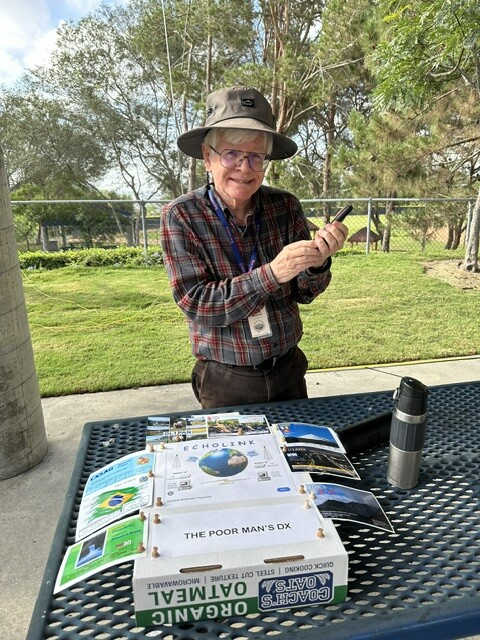

*Mark demoed contacts made all over the world with EchoLink. Photo by Ed Barnes, WA6ED.*

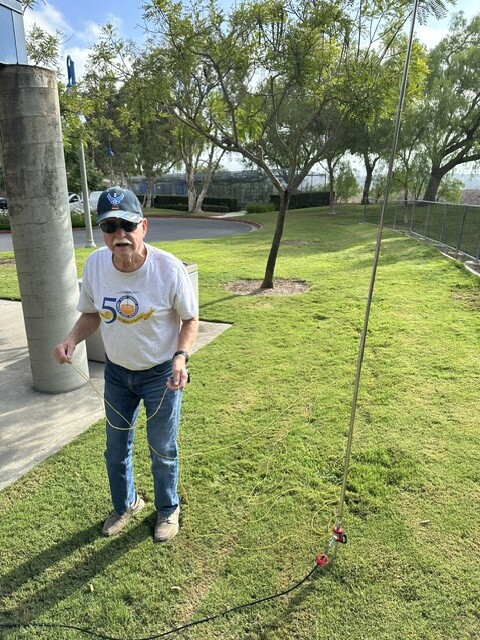

*Ray is setting up his HF vertical antenna. Photo by Ed Barnes, WA6ED.*

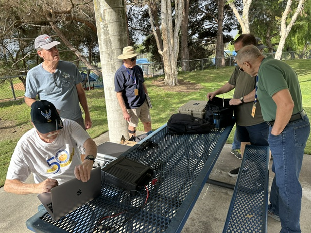

*Ray and Ray setting up. Maybe Winlink? Not sure… Photo by Ed Barnes, WA6ED.*

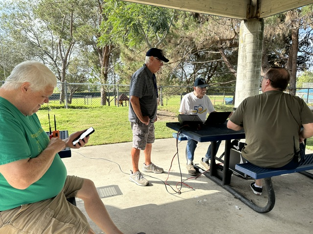

*Brian and everyone having a good time. Photo by Ed Barnes, WA6ED.*

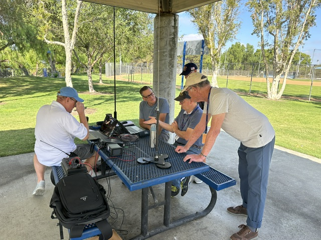

*David, Greg, Claude working JS8Call. Photo by Ed Barnes, WA6ED.*

73,

Ed, WA6ED

## Recommended Links

A few links worth checking out this month:

- **[FreeDV Explained: Open-Source Digital Voice for HF Bands](https://youtu.be/vv2ceThcJRg)** (Ham Radio Prep, YouTube). In anticipation of this month's live RADE demo at the membership meeting, here's an introduction to FreeDV. Shared by Ray Frericks, K6NOV.
- **[W6 SOTA](https://w6sota.org/web/)**, our local Summits on the Air resource. Shared by Ray Frericks, K6NOV.

## Keyboard APRS Messaging: PinPoint APRS + Digirig + Soundmodem on a Yaesu FTM-6000

*By Kevin Brouelette, AJ6EE*

### Why this setup?

APRS is more than dots on a map. It is also a way to send short text messages over the air, station to station or to a whole group, without cell service or the internet. That makes it a useful tool for both emergency and non-emergency events: public service events, drills, hikes, and any time a short written message is clearer than a voice call.

Most licensed hams already own something with APRS capability, but many have never used it for messaging. Part of the reason is that typing a message one letter at a time on a radio keypad is slow. A computer changes that. With a full keyboard and screen you can send clear, complete messages quickly, read everything that comes in, and keep a record of it all.

This article shows how I set up a computer-based APRS messaging station using a Yaesu FTM-6000, a Digirig interface, and two free Windows programs: Soundmodem and PinPoint APRS.

### How the pieces fit together

| Yaesu FTM-6000 | → | Digirig | → | Soundmodem | → | PinPoint APRS |
|:---:|:---:|:---:|:---:|:---:|:---:|:---:|
| 2 m / 70 cm radio | 10-pin DATA cable | audio + PTT | USB | software TNC | KISS TCP :8100 | map + messages |

**The radio.** The FTM-6000 is a solid 2 m/70 cm mobile with a data port on the back, but it has no APRS capability built in: no TNC, no message screen, no beaconing. This setup turns it into a full APRS messaging station with a real keyboard. The same approach works with almost any radio that has a data port, so many members can do this with a rig they already own.

**The Digirig.** The Digirig is a small USB interface that sits between the radio's data port and the computer. It lets PinPoint APRS hear APRS packets coming from the radio, send APRS packets back to the radio, and key the radio to transmit when a message or beacon needs to go out. One USB cable to the computer and one cable to the radio is the whole hardware setup.

**Soundmodem.** Soundmodem (free for Windows, by UZ7HO) is the software that connects the Digirig to PinPoint APRS. It acts as the TNC: it turns the packet tones heard through the Digirig into data PinPoint can read, and turns PinPoint's outgoing messages into tones for the radio to transmit. It runs quietly in the background, and PinPoint connects to it using KISS.

**PinPoint APRS.** PinPoint is the part you actually use: the map, the station list, and the message window.

### What you need

- Radio: Yaesu FTM-6000 (any radio with a data port works with the matching cable).
- Digirig Mobile USB audio/PTT interface. The USB-A to USB-C cable comes in the box.
- Digirig Yaesu FTM Mini-DIN-10 cable, 1200 baud version. It has a 10-pin mini-DIN plug for the radio on one end and two 3.5 mm plugs for the Digirig on the other.
- A Windows computer, laptop or desktop.
- Software (all free): Soundmodem, PinPoint APRS, and the Silicon Labs CP210x driver. Links are in the Resources section at the end.

### Connecting it

1. Install the CP210x driver on the computer. It gives Windows the COM port the Digirig uses for PTT.
2. Plug the 10-pin mini-DIN end of the cable into the DATA jack on the back of the FTM-6000.
3. Plug the two 3.5 mm plugs into the Digirig: green goes to the serial (PTT) port and black goes to the audio port.
4. Connect the Digirig to the computer with the included USB cable.
5. In Windows Device Manager, look under Ports (COM & LPT) for the new COM port and note the number. You will need it for Soundmodem.

### Radio setup (FTM-6000)

- Tune the radio to 144.390 MHz, the North American APRS frequency.
- Set Menu 16 PKT.SPD to 1200BP: press and hold [F menu], turn the DIAL to 16 PKT.SPD, press the DIAL, select 1200BP, and press to confirm.
- Turn off Dual Watch and scanning so the radio stays on 144.390.
- Open the squelch (turn it all the way off). Soundmodem does its own detection, and an open squelch keeps the radio from cutting off the start or end of a packet. The radio's volume knob only sets the speaker level and does not affect the audio going to the Digirig, so set it wherever is comfortable (or all the way down for a quiet station).

> **Important:** the FTM-6000's PKT.SPD setting defaults to 9600BP from the factory. APRS runs at 1200 baud, so this has to be changed or nothing will decode.

### Setting up Soundmodem

Soundmodem has two settings screens, Settings → Devices and Settings → Modems.

**Devices screen**

- Output / Input device: choose Speakers (USB Audio Device) and Microphone (USB Audio Device). That is the Digirig.
- Sample rates: leave TX and RX at 11025.
- Single channel output: checked. Dual channel: unchecked.
- KISS Server Port: 8100, Enabled. This is the port PinPoint APRS connects to.
- AGWPE Server Port: not needed; leave it unchecked.
- PTT Port: the Digirig's COM port (COM4 on my computer). Yours will probably be different; use the number you found in Device Manager.

**Modems screen**

- Channel A mode: AFSK AX.25 1200bd, standard APRS.
- TXDelay: 250 ms. TXTail: 50 ms.
- Leave the filters on Default settings. Channel B is ignored in single channel mode.

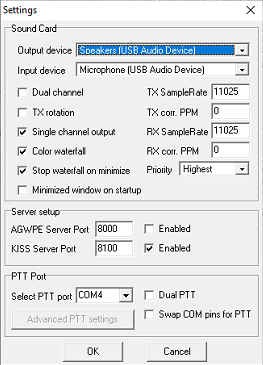{: style="height:3.2in; width:auto"} 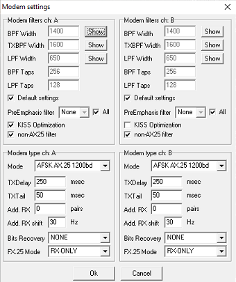{: style="height:3.2in; width:auto"}

*Soundmodem Settings → Devices (left) and Settings → Modems (right). Screenshots by Kevin Brouelette, AJ6EE.*

**Main window**

Check that channel A shows AFSK AX.25 1200bd and the center frequency is 1700 Hz (the arrows below). When the radio hears APRS traffic, packets scroll by in the main window and the tones appear on the waterfall at the bottom. That is your first sign the radio, Digirig and Soundmodem are all working together.

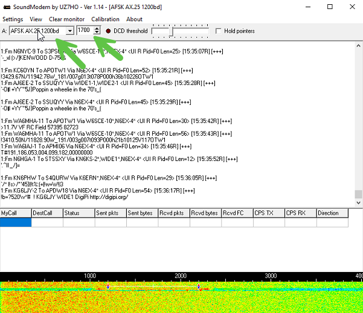

*Soundmodem main window decoding live APRS traffic. Screenshot by Kevin Brouelette, AJ6EE.*

> **Tip:** plugging in the Digirig can make Windows switch its default sound device to it. Set your computer's normal speakers back as the default playback device, or Windows sounds (notifications, beeps) may end up transmitted over the air.

### Setting up PinPoint APRS

Open Tools → Options.

**TNC tab**

- TNC type: network KISS mode.
- Connect TNC automatically when PinPoint APRS starts: checked.
- TCP/IP address: 127.0.0.1 ("this computer," since Soundmodem runs on the same machine).
- Port: 8100. It must match Soundmodem's KISS port.
- Ignore the Serial TNC Settings section; it is only used with a hardware TNC.

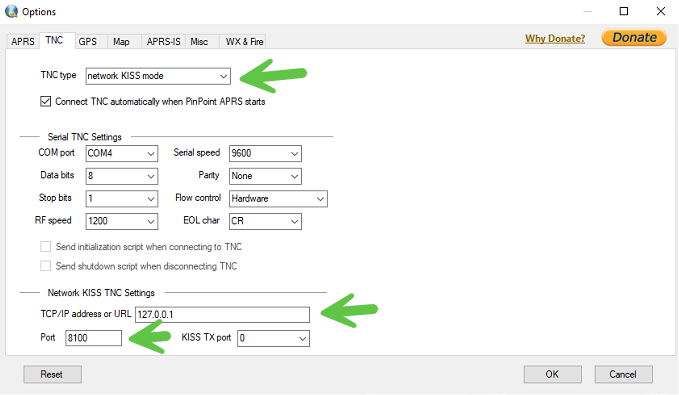

*PinPoint APRS Options → TNC tab. Screenshot by Kevin Brouelette, AJ6EE.*

**APRS tab**

- My APRS Call sign + SSID: your callsign with an SSID (I use AJ6EE-1).
- APRS path: WIDE1-1,WIDE2-1.
- Position comment: optional short text sent with your beacon.
- Station icon: any icon you like.
- Enable APRS beaconing: checked. For a fixed station, a long interval such as 360 minutes (6 hours) keeps you on the map without adding traffic to the channel.
- Use RF (Radio): checked. Use APRS-IS (Internet): unchecked. Everything goes over the air, which is the point for emergency use.
- APRS DigiPeater: leave it off.

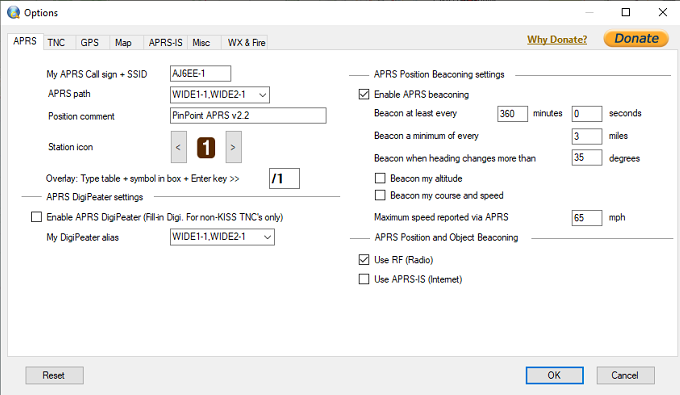

*PinPoint APRS Options → APRS tab. Screenshot by Kevin Brouelette, AJ6EE.*

**Main screen**

The status bar at the bottom shows whether everything is connected. Look for TNC Connected and Beaconing Enabled. Stations heard on the air appear on the map, and new messages are counted in the status bar.

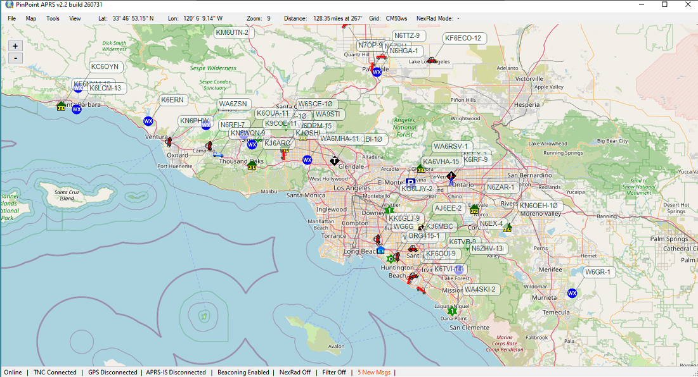

*PinPoint APRS main screen: stations heard over RF, with TNC Connected in the status bar. Screenshot by Kevin Brouelette, AJ6EE.*

### Using PinPoint APRS

- **F1:** beacon now. Transmits your position immediately. A good first test: watch Soundmodem or listen to the radio to confirm it transmits.
- **F10:** Messages window. Where you read and send APRS messages.
- **View → Communications:** opens the Communications Monitor, a live view of received APRS traffic.

**Sending and reading messages (F10)**

The Messages window works much like an email program:

- Folders on the left: Inbox (with Bulletins), Sent, Drafts and Deleted Items.
- New starts a message. Enter the destination and your text, then send it.
- Reply answers the selected message. Re-send sends one again if it was not acknowledged.
- Reading Pane shows the full text of the selected message at the bottom.

Your Sent folder keeps a time-stamped record of every message, which is useful for logging during an event.

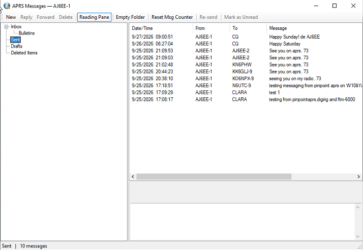

*PinPoint APRS Messages window (Sent folder) showing messages to stations, CQ and the CLARA group. Screenshot by Kevin Brouelette, AJ6EE.*

**Communications Monitor**

This window shows the same live traffic as Soundmodem's monitor, but it is easier to read: one line per packet, each with a timestamp. It also has Save Data to keep a log, which is handy after an event.

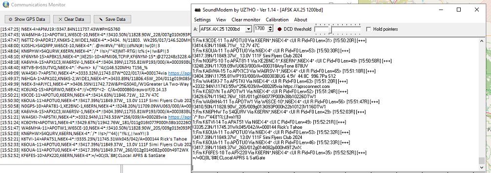

*PinPoint's Communications Monitor (left) next to Soundmodem's monitor (right): same traffic, cleaner layout. Screenshot by Kevin Brouelette, AJ6EE.*

### APRS groups

An APRS message is addressed to a name of up to nine characters. Usually that name is a callsign with SSID, such as KN6PHW or AJ6EE-2, and the message goes to that one station. But the address does not have to be a callsign. It can be a group name, and any station set up to watch for that name will show the message.

That is what makes groups useful for events. Instead of sending the same message to five people one at a time, you send it once to the group, and everyone on the team sees it.

**Built-in and custom groups**

- Yaesu APRS radios come with ALL, CQ, QST and YAESU preset as group codes, with empty slots for your own. Other brands have similar group or bulletin settings.
- CQ is the general "anyone listening?" group, and a good way to say hello on APRS.
- A custom group is any name your group agrees on, for example CLARA. Each member adds it to an empty group slot on their radio. In PinPoint, simply enter the group name as the destination.

**Tips for using groups**

- Agree on the name ahead of time and have everyone add it before the event. Keep it short, unique, and no more than nine characters.
- Group messages are generally not acknowledged the way station-to-station messages are. For anything important, ask for a reply or send it directly to the station who needs it.
- Keep messages short. 144.390 is a shared channel, so avoid repeating messages rapidly.
- Bulletins (sent to BLN addresses) show up in PinPoint's Bulletins folder and are useful for announcements to everyone in range.

### Quick troubleshooting

| Symptom | Check |
|---|---|
| No COM port for the Digirig | Install the CP210x driver, then unplug and replug the Digirig. |
| Nothing decodes in Soundmodem | Radio on 144.390? PKT.SPD set to 1200BP? Input device set to the USB Audio Device? |
| Radio will not transmit | Soundmodem PTT Port matches the Digirig COM port; green plug is in the serial port. |
| PinPoint says TNC disconnected | Soundmodem is running; KISS port is 8100 in both programs; address is 127.0.0.1. |
| Windows sounds going out on the air | Set the computer's own speakers back as the default playback device. |

### Resources

- PinPoint APRS: free APRS client for Windows (map, messaging, station list). [pinpointaprs.com](https://www.pinpointaprs.com)
- Soundmodem (UZ7HO): free software TNC for Windows. [uz7.ho.ua/packetradio.htm](http://uz7.ho.ua/packetradio.htm)
- Digirig: audio/PTT interface and radio-specific cables. [digirig.net](https://digirig.net)
- Digirig Yaesu FTM Mini-DIN-10 cable (1200 baud version). [digirig.net/product/yaesu-ftm-cable](https://digirig.net/product/yaesu-ftm-cable)
- Silicon Labs CP210x USB-to-UART driver: provides the Digirig's COM port for PTT. silabs.com, USB-to-UART VCP drivers

73, AJ6EE

## Treasurer's Report

| Twelve Months | September 2026 | September 2025 | Increase/(Decrease) |
|---|---:|---:|---:|
| **Cash Income:** | | | |
| Memberships | $8,669.00 | $9,871.00 | $(1,202.00) |
| Other & Interest | $2,427.55 | $3,933.00 | $(1,505.45) |
| **Total Cash Income** | **$11,096.55** | **$13,804.00** | **$(2,707.45)** |
| **Cash Expenses:** | | | |
| Repeaters incl. site rental, utilities & insurance | $7,076.33 | $6,642.00 | $434.33 |
| Member Activities | $4,016.36 | $2,966.00 | $1,050.36 |
| Other expenses | $2,939.89 | $1,261.00 | $1,678.89 |
| **Total Cash Expenses** | **$14,032.58** | **$10,869.00** | **$3,163.58** |
| **Cash Net Income** | **$(2,936.03)** | **$2,936.00** | **$(5,871.03)** |
| Beginning Cash — October 1 | $28,179.03 | $25,745.00 | $2,434.03 |
| Ending Cash — September 30 | $25,243.07 | $28,681.00 | $(3,437.00) |

*If any member has questions about the financials, please contact the Treasurer or
any Board member.*

<!-- ===================================================================
     SOARA Information — standard evergreen back page. Renders as a compact
     two-column single page (the build tool wraps this section automatically).
     Keep this section LAST. Verify every callsign, contact, frequency, and the
     meeting schedule against shared/club-information.md before publication.
     =================================================================== -->

## SOARA Information

**Meetings:** SOARA meets at the Norman P. Murray Center, 24932 Veterans Way,
Mission Viejo, CA on the third Monday of every month at 6:30 PM. For January and
February, the third Monday is a holiday and the meeting is held on the fourth
Monday.

**License Exams:** Amateur license exams are given prior to SOARA meetings, except
June. Exams are at 6:00 PM. Prior registration is not required and walk-in
applicants are welcome. For June, exams are held at Field Day. For further
information, email Steve Kuver, K6UVR, at k6uvr@soara.org.

**SOARA Library:** SOARA has many amateur radio related books such as handbooks,
books about electrical theory, and more available to lend to club members. Contact
library@soara.org for more information.

**Web Site:** SOARA maintains a web site with current club information at soara.org.

### Repeaters

The Laguna Beach, San Clemente, and Trabuco repeaters are open. The Santiago Peak
repeaters are closed. For details or questions on the repeaters, contact the
repeater director at repeater@soara.org.

| Band | Frequency | Shift | Tone / Notes | Location |
|---|---|---|---|---|
| 2m | 147.645 | − | (110.9) | Laguna Beach |
| 2m | 146.025 | + | (110.9) | San Clemente |
| 2m | 145.240 | − | (110.9) | Trabuco |
| D-STAR 2m | 146.115 | + | (K6SOA C) | Laguna Beach |
| 220 | 224.100 | − | (110.9) | Laguna Beach |
| 220 | 224.640 | − | (pvt) | Santiago Peak (C) |
| 440 | 445.660 | − | (110.9) | Laguna Beach |
| D-STAR 440 | 445.705 | − | (K6SOA B) | Laguna Beach |
| 440 | 447.180 | − | (pvt) | Santiago Peak (C) |
| D-STAR 1.2G | 1282.600 | − | (K6SOA A) | Laguna Beach |

### Nets

- 40 meter HF (7.200 MHz +/−): Sundays at 8:00 AM
- 10 meter HF (Technicians welcome) (28.415 +/−): Sundays at 9:00 AM
- General Membership Net — UHF/VHF (447.180, 147.645 & 224.640): Tuesdays at 8:00 PM
- D-STAR (146.115 C module): Wednesdays at 8:00 PM
- Tech Net — 147.645, 224.640, 447.180: Saturdays at 9:00 AM
- California Rescue Communications (Gordo Net) HF (7.250 MHz +/− for QRM): Weekdays at 8:30 AM
- MVRACES — 447.180: Tuesdays at 7:00 PM
- Tri-Cities RACES — 146.025: Wednesdays at 8:00 PM
- LNACS — 147.645: Thursdays at 7:00 PM
- OC Parks Fire Watch — 447.180: Thursdays at 8:00 PM

### SOARA Officers

- **President:** Dale Tyler, W6EDT — w6edt@soara.org — 949-360-1717
- **Vice President:** Greg Unruh, WE4BY — we4by@soara.org
- **Secretary:** Charles Schultz, NY6I — ny6i@soara.org
- **Treasurer:** Ron Mosher, K0PGE — k0pge@soara.org — 949-363-0047

### SOARA Directors

- **Repeater:** Open
- **Publications:** Ray Frericks, K6NOV — k6nov@soara.org
- **Membership:** Open
- **Education:** Steve Kuver, K6UVR — k6uvr@soara.org — 949-874-1972
- **Technical:** Tom Hobbs, AE6SH — ae6sh@soara.org — 949-887-6527
- **Communications:** Ray Hutchinson, AE6H — ae6h@soara.org

### SOARA Appointments

- **Past President:** Ray Hutchinson, AE6H — ae6h@soara.org
- **Activities Coordinator:** Open
- **SOARA Saturdays:** Ed Barnes, WA6ED — wa6ed@soara.org — 949-468-7706
- **Raffle:** Open
- **Testing:** Steve Kuver, K6UVR — k6uvr@soara.org
- **Website:** Open

### Contacting SOARA

Website: soara.org &nbsp;|&nbsp; Membership: membership@soara.org &nbsp;|&nbsp;
Postal: P.O. Box 2545, Mission Viejo, CA 92690 &nbsp;|&nbsp; Facebook: K6SOA
&nbsp;|&nbsp; Twitter/X: @K6SOA

*Dates, locations, times, and frequencies are subject to change. Check the SOARA
website before attending an event.*
