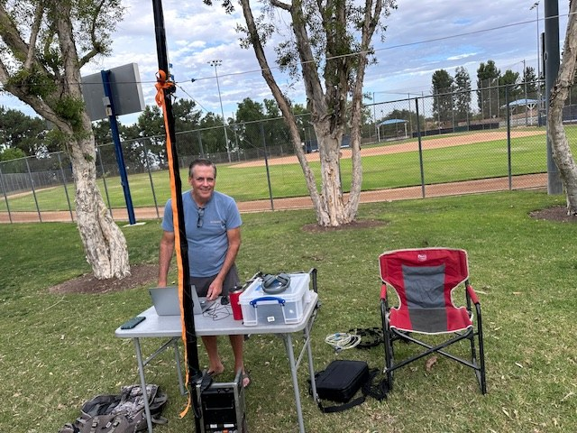
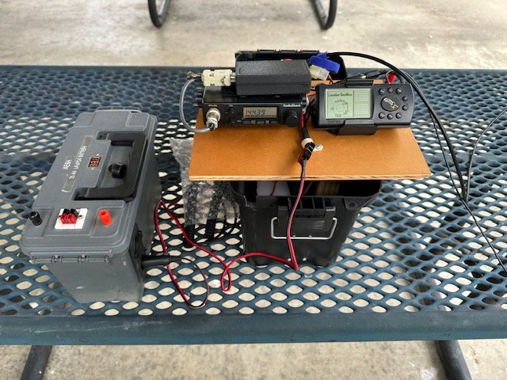
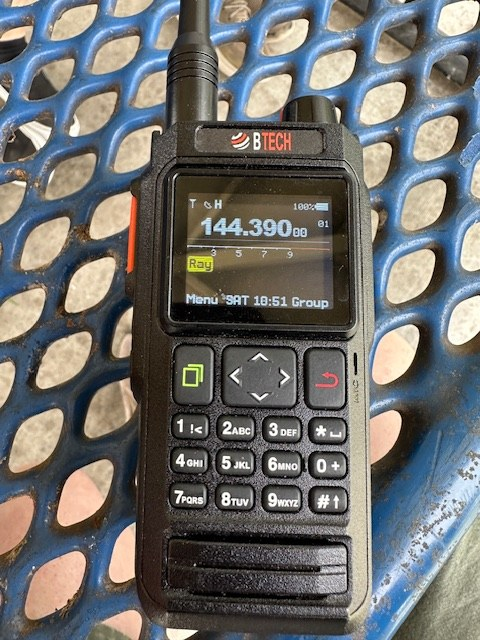
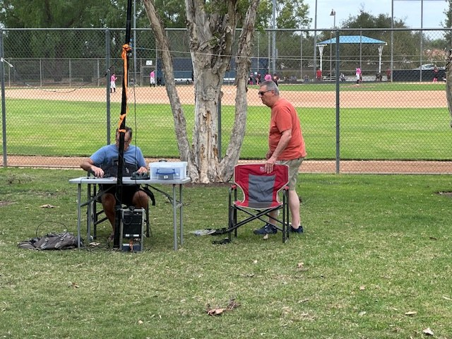
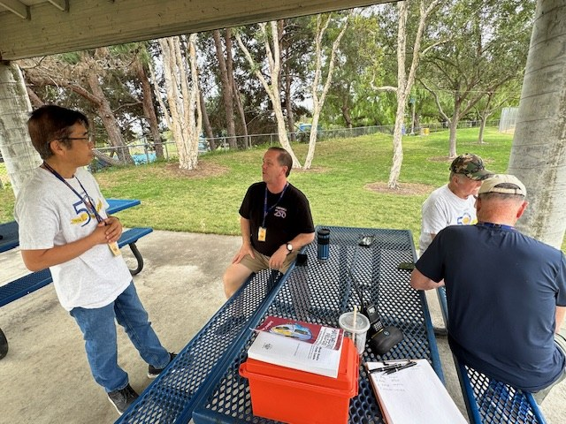
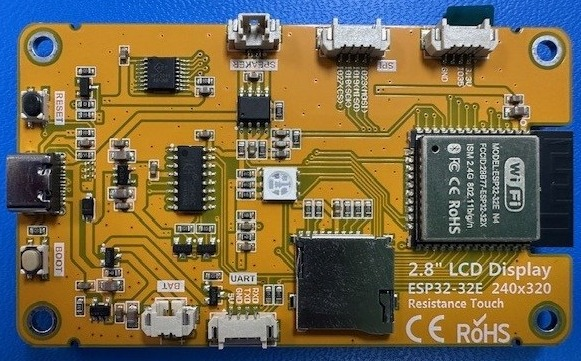
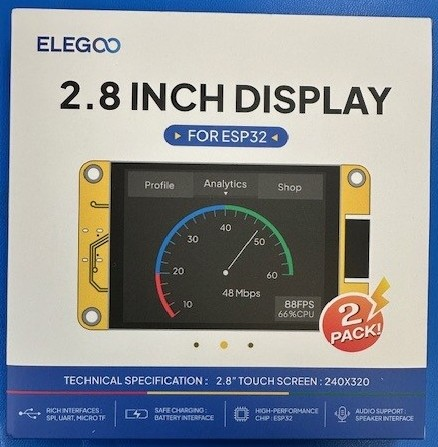
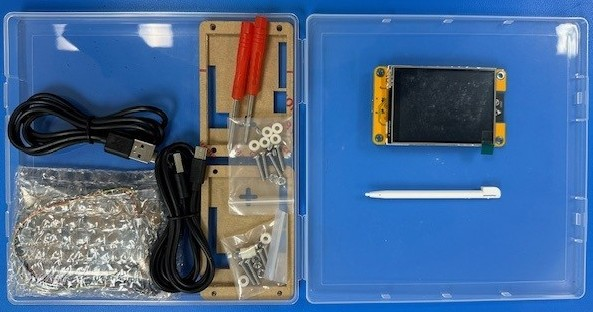

# The Propagator

**South Orange Amateur Radio Association | November 2026**

<!-- First-pass draft for Ray Frericks, K6NOV. Not for publication.
Upcoming SOARA Events stays FIRST. SOARA Information stays LAST. -->

## Upcoming SOARA Events

<!-- Prepared from calendar.md on 2026-11-08. December board meeting and
December license exams are unresolved and are not listed. Auction setup time
follows Ron K0PGE and the soara.org auction page, not Dale's 5:45 PM line.
Holiday Party venue follows the soara.org page (Palo Verde Room, Murray Center),
not Dale's "Mission Viejo Community Center." Both conflicts are unedited in the
contributors' own sections. -->

### This Month — November 2026

| Date | Time | Event | Location |
|---|---|---|---|
| Monday, November 16 | 6:00 PM | Ham Radio License Exams | Murray Center |
| Monday, November 16 | 6:00 PM setup, 6:30 PM start | SOARA Live Auction (in place of the membership meeting) | Murray Center |
| Saturday, November 21 | 9:00 AM–noon | SOARA Elmer Saturday — Kit building | Murray Center |
| Monday, November 23 | 7:00 PM | Board Meeting | Murray Center |

### Next Month — December 2026

| Date | Time | Event | Location |
|---|---|---|---|
| Friday, December 4 | 6:00–9:00 PM | Holiday Party — $40 per person, advance payment only (no regular membership meeting) | Murray Center, Palo Verde Room |
| Saturday, December 19 | 9:00 AM–noon | SOARA Elmer Saturday | Murray Center |

*Dates, locations, and times are subject to change. Check the
[SOARA website](https://www.soara.org) before attending.*

## President's Message

The days are getting shorter and it is almost time for a couple of SOARA's fall events. First, we have the auction on November 16, 2026, with setup starting at 5:45 PM, viewing starting at 6:00 PM, with auction starting promptly at 6:30 PM. We will be making one pass through all of the items displayed, take a short break and then make a second and final pass through all of the unsold items left over from the first pass. The selling will stop at or before 8:15 PM, even if not every item has sold. Details about the auction can be found at: [https://www.soara.org/club-calendar/live-auction/](https://www.soara.org/club-calendar/live-auction/). If you plan to see or plan to bid, you MUST get a bidder/seller card prior to the auction start. Again, look at the web page shown above.

Thanks to some very generous donors, SOARA will have a number of very nice Elecraft, Icom and Yaesu HF transceivers and 100W linear amplifiers (subject to testing), Buddipole antennas, wire antennas as well as a lot of assorted meters, antenna tuners, antenna switches, power distribution panels, switching power supplies, Morse keys and test equipment. A list will be available on the website as the transceivers, amplifiers, and are tested. There will be a power supply and dummy load available at the auction for you to power on the equipment and observe them operate.

To best honor the value of the higher value donations, there will be a minimum bid established, below which the item cannot be sold. This will ensure that SOARA will receive proper value for these items and also that no one will get a very valuable item at an unfairly low price. The minimum bid will be shown on the auction tag for these items. Other sellers may also choose to set a minimum price.

This is a great opportunity to get some updated equipment for your shack or next POTA activation.

After the auction, the next big event for SOARA is our annual Holiday Party. It will be held Friday, December 4, 2026 from 6-9 PM at the Mission Viejo Community Center. The cost will be $40 per person and reservations are required. Tickets will NOT be sold at the door. RSVP and advance payment are required.

Based on the success of last year's Holiday party, we will be using the same caterer and the same menu, Rosemary Chicken Breast, Millionaire Skirt Steak, Margarite Pasta, House Salad and French Bread & Butter. We will also have a platter of grilled vegetables.

There will also be some gift certificates for Ham Radio Outlet. For more details see: [https://www.soara.org/club-calendar/holiday-party/](https://www.soara.org/club-calendar/holiday-party/)

Finally, the notice for SOARA membership renewal went out on November 2, a little later than usual. I hope that everyone reading this will decide to renew your membership in SOARA. If you did not receive a dues reminder, please email me at w6edt@soara.org and I'll try and figure out what went wrong. You can pay your dues at: [https://amp.soara.org/btp/run/](https://amp.soara.org/btp/run/). Please check your renewal letter and pay the amount shown if it is different from the standard amount. If you have any questions, please contact me at the email shown above.

I hope you will continue to support SOARA. This is your club and we need your help to continue bringing you all of the speakers, nets and events as well as operating and maintaining our VHF/UHF repeaters.

I look forward to seeing you at the auction and Holiday Party.

73,

Dale (W6EDT)

## Membership Meeting

### SOARA Auction — Monday, November 16, 2026

Setup & Viewing: 6 PM; Auction begins: 6:30 PM

It's that time again, time to sell the gear you don't want and make room for the bargains you find at the auction. The auction will operate the same this year as it has during the past three years.

1. Sign in upon arrival.

2. Each participant will receive a prenumbered Bidder Card and all bidding and sales will be recorded using the bidder number. SOARA member Bidder Cards will be preprinted. Nonmember Bidder Cards will be printed at the door.

3. Each item, or group of items, being offered for sale will have a Lot Tag which will be preprinted with the Bidder Card number of the seller and a preassigned Lot Number. If you let us know how many Lots you might want to sell, we will preprint your Lot Tags with your number and the Lot Tag numbers. You will only need to hand-write the Lot Description on each Lot Tag.

4. However, if you want to make it even easier for yourself on auction night, email me a description of the items you think you might sell, we will preprint the description on your Lot Tags. In that case, when you arrive, all you have to do is pick up your Bidder Card and the fully-prepared Lot Tags at the door and attach them to the items you are selling.

5. Requesting Lot Tags does not obligate you in any way. You can discard any unused Lot Tags or ask for additional ones. If you make a last-minute decision to bring items for auction, your Lot Tag numbers, will be printed at the door, which will take extra time. You will have to hand-write the item descriptions.

6. Remember, once you place a sale item in the auction area, it cannot be removed until it has sold or failed to sell.

7. For the Lot Tag printing to be done in advance, we need to know how many Lot Tags you want and the Descriptions, if you want the Descriptions preprinted. The deadline for letting us know what you would like preprinted is Friday, November 13. Any information received after that time will not be preprinted. Providing Lot Tag information early will be very helpful.

8. No Lot tags will be printed after the auction begins at 6:30 PM.

9. Even if a person says he is bringing a specific item to be auctioned, there is no obligation to bring it. If you are coming to the auction to bid on a specific item, you must actually see it in the auction room before you can be certain that it will be there.

10. Questions and information regarding Bidder Cards or Lot Tags should be sent to K0PGE@SOARA.org.

We anticipate a fun and rewarding evening of buying and selling radio-related gear on Monday, November 16.
See the SOARA website for auction rules.
Hope to see you there!
Ron

## SOARA Saturday Report

### October 17, 2026 Recap

Hi all,

Thanks to everyone who came out to Elmer Saturday on October 17. We had a good turnout and plenty of radio talk.

Attendees: Ed WA6ED, Greg WE4BY, Greg N6PM, Ray K6NOV, Ray AE6H, Jimmy KK6TTL, Claude W6CAG, Patti AD6OH

Thank you, Greg! Greg WE4BY brought the coffee and donuts.

### Demos

*Greg WE4BY set up a portable HF station in the park. Photo by Ed Barnes, WA6ED.*

*Ray AE6H set up an older APRS station: a mobile rig on 144.390 MHz paired with a vintage Garmin GPS, all running off a battery box. Photo by Ed Barnes, WA6ED.*

*We also looked at the BTECH UV-Pro, a waterproof (IP67) handheld with built-in APRS, GPS and Bluetooth. It runs about $167 on Amazon and is shown here tuned to 144.390 MHz. Photo by Ed Barnes, WA6ED.*

### Around the Room

*Greg WE4BY and Greg N6PM talking radio at the HF station. Photo by Ed Barnes, WA6ED.*

*Jimmy KK6TTL, Ray K6NOV, Claude W6CAG and Ray AE6H talking radio. Photo by Ed Barnes, WA6ED.*

### Donut Fund

<ul style="break-inside: avoid">
<li>Starting balance: $55</li>
<li>Paid out: $20 to Greg WE4BY for donuts</li>
<li>Collected: $12</li>
<li>Balance carried forward: $47</li>
</ul>

### Next Meeting: Saturday, November 21, 2026

- Time: 9:00 AM to noon
- Where: Murray Center
- Theme: Kit building

Bring a kit you'd like to build, and please RSVP by Wednesday, November 18 if you plan to build so I know whether to bring my soldering gear. Other demos are welcome too.

73,

Ed, WA6ED

## Club News and Opportunities

### December Holiday Party

December has no regular membership meeting. Instead, SOARA holds its annual
Holiday Party on Friday, December 4, from 6 to 9 PM in the Palo Verde Room at the
Norman P. Murray Center.

Dinner is a catered buffet with salad, a main entree and dessert. The club
provides water, soda and sparkling cider, and you're welcome to bring your own
wine or beer; hard liquor isn't permitted. Members, friends and family are all
welcome, and non-members can buy tickets too.

Tickets must be purchased in advance through the Membership tab on soara.org, by
choosing "Pay Dues Online." They will not be sold at the door. The ticket price
is $40 per person.

The Richard Coyne WW7D Memorial Award, which recognizes a member who made an
outstanding contribution to the club and the ham community over the past year, is
presented at the party.

## Recommended Links

A few links worth checking out this month:

- **[Facebook reel](https://www.facebook.com/reel/2732795223848329).** See how Morse code was woven into a TV series theme song. Shared by Ray Frericks, K6NOV.
- **[Which HT Actually Works For Shortwave Listening](https://www.youtube.com/watch?v=1a362_4Amrg)** (KM4ACK, YouTube). Shortwave listening (SWL) with a handheld radio (HT). Shared by Ray Frericks, K6NOV.

## The Cheap Yellow Display

*SHACK PROJECTS · EXTENDED EDITION*

A $15 shack gadget: what it is, what to buy, and how to turn it into a HamClock-style dashboard

**By Ed Barnes · November 3, 2026**

*The back of the author's Elegoo board: ESP32-WROOM-32E module (right), microSD slot (bottom center), battery and UART connectors (bottom), RESET and BOOT buttons beside the USB-C port (left), and speaker and SPI connectors (top). Photo by Ed Barnes, WA6ED.*

### At a Glance

| Cost | Setup | You need | Power | Best firmware |
|---|---|---|---|---|
| About $14 per board (Elegoo 2-pack, $27.99) | About 10 minutes with a web flasher, no coding | Chrome or Edge, a USB data cable, your callsign and grid square | Under 1 W from 5 V USB | CYD Ham Dashboard by HenrysCat |

### Why a $15 board belongs in the shack

For about the price of a coax jumper, you can buy a Wi-Fi computer with a color touchscreen already attached. Hobbyists call it the Cheap Yellow Display, or CYD, after the yellow circuit board on the back.

For hams, that adds up to a small, low-power screen that can sit on the operating desk and show the things we check all day: UTC time, solar and band conditions, DX spots, satellite passes, and station status. No Raspberry Pi, no monitor, no SD card to corrupt.

This extended edition covers what the board is, which version to buy, how to load software without writing code, a survey of ham-friendly projects, and a step-by-step guide to turning one into a HamClock-style dashboard.

### What is the CYD?

The CYD is an ESP32 microcontroller, a 2.8-inch 240×320 color touchscreen, and a microSD slot on one board. The name comes from Brian Lough (witnessmenow), whose GitHub repository became the community hub for the original Sunton ESP32-2432S028R. This article uses the Elegoo 2.8-inch ESP32-32E display (model E32R28T), a close cousin with the same screen and touch wiring, tested by the author with the CYD Ham Dashboard.

| Feature | Elegoo 2.8-inch ESP32-32E (E32R28T) |
|---|---|
| Processor | ESP32-WROOM-32E module, dual-core 240 MHz, Wi-Fi and Bluetooth |
| Flash | 4 MB |
| Display | 2.8-inch, 240×320, TN panel, ILI9341 driver over SPI |
| Touch | Resistive, XPT2046 controller |
| Storage | microSD slot |
| USB | Single USB-C; enters download mode automatically |
| Battery | 3.7 V LiPo connector with onboard charger |
| Extras | RGB LED, speaker connector, SPI and serial connectors |
| Power | 5 V, about 0.65 W with the display on |
| Board size | 50 × 86 mm |
| Price | $27.99 for a 2-pack on Amazon (Nov 2, 2026) |

Source: [LCDWIKI E32R28T specification (PDF)](https://www.lcdwiki.com/res/E32R28T/E32R28T_E32N28T_Specification_V1.0.pdf); price checked by the author. LCDWIKI (Shenzhen QDtech) designs this board; Elegoo sells it under its own name, so you will see both names on spec sheets.

Two limits matter for shack projects. First, few GPIO pins are free; the SPI and serial connectors are the easiest way to add sensors. Second, the TN panel looks best head-on, so mount it facing the operating position.

Want a bigger screen? You may want to order the 4-inch version instead, for about $5 more per board. Its 480×320 display shows larger text and more DX and POTA spots, and the CYD Ham Dashboard flasher has a 4-inch (ST7796S) build. The author has not tested the 4-inch board, so check that the listing names the ST7796S driver.

### How it compares with the original CYD

The Elegoo board and the original Sunton ESP32-2432S028R use the same screen, the same touch controller, and the same pins for both, so CYD firmware built for the ILI9341 panel runs on either. The differences are in the extras.

| Feature | Classic CYD (ESP32-2432S028R) | ESP32-32E (E32R28T) |
|---|---|---|
| Module | ESP32-WROOM-32 | ESP32-WROOM-32E, 4 MB flash |
| Display | 2.8" ILI9341, SPI on GPIO 14/13/12, CS 15, DC 2 | Same panel and same pins |
| Backlight | GPIO 21 | GPIO 21 |
| Touch | XPT2046 on GPIO 25/32/39, CS 33, IRQ 36 | Same controller and same pins |
| USB | Micro-USB, or micro-USB plus USB-C on later boards | Single USB-C with automatic download mode |
| Battery | None | 3.7 V LiPo connector with onboard charger |
| Light sensor | LDR on GPIO 34 | None; GPIO 34 reads battery voltage |
| RGB LED (red) | GPIO 4 | GPIO 22; GPIO 4 enables the audio amplifier |
| Extra connectors | Extended IO headers | SPI peripheral, serial, and IO35 input connectors |
| Power | About 0.6–0.9 W | 0.65 W display-only (130 mA at 5 V) |

Sources: [LCDWIKI E32R28T specification (PDF)](https://www.lcdwiki.com/res/E32R28T/E32R28T_E32N28T_Specification_V1.0.pdf), [atomic14 CYD page](https://www.atomic14.com/esp32/boards/esp32-2432s028r/), [Home Assistant community thread on the E32R28T](https://community.home-assistant.io/t/ili9xxx-spi-broken-in-2026-1-1-solved-e32r28t/978625).

What that means in practice:

Use the ILI9341 build of CYD firmware. The author's E32R28T runs HenrysCat's CYD Ham Dashboard with this build. Newer boards marked E32R28T-1 use an ST7789 panel and need the ST7789 build.

Expect small differences. Features tied to the light sensor or the red LED may not behave the same, because those pins do different jobs on this board.

The battery connector is a bonus for field use. A small 3.7 V LiPo turns the dashboard into a portable POTA or Field Day display.

Flashing is simpler. The USB-C port enters download mode on its own, so you rarely need the BOOT button.

Buy by model number. The author's board is an Elegoo, sold on Amazon as a 2-pack. Search for "Elegoo ESP32 2.8", "E32R28T" or "2.8inch ESP32-32E" to get this board, or "ESP32-2432S028R" for the classic.

### Where to buy and what to pay

Buy the Elegoo ESP32-32E (E32R28T) 2.8-inch display on Amazon: $27.99 for a 2-pack, about $14 each, as of Nov 2, 2026. It is the board the author tested with the CYD Ham Dashboard, and it arrives in 1–3 days with easy returns. Search Amazon for "Elegoo ESP32 2.8" or "E32R28T" to find it. Price checked by the author; Amazon prices change often.

*The Elegoo 2-pack as sold on Amazon. Photo by Ed Barnes, WA6ED.*

*What's in the box: the display, acrylic case panels with mounting screws and standoffs, two small screwdrivers, USB cables, connector leads, and a touch stylus. Photo by Ed Barnes, WA6ED.*

For a bigger screen, you may want to order the 4-inch version for about $5 more per board; see the note under "What is the CYD?" before you buy.

A club group buy works well here: a 2-pack or 5-pack lowers the per-board cost, and having a few identical boards makes a build night much easier to support.

### Getting started: four ways in

Most hams should start with a web flasher: no code, no toolchain, about five minutes. The other three paths are there when you want to customize.

| Path | Skill needed | What you do | Good for |
|---|---|---|---|
| Web flasher | None | Plug in USB, open a web page in Chrome or Edge, click Install | Ready-made dashboards and tools |
| Arduino IDE / PlatformIO | Some C++ | Install ESP32 board support plus the TFT_eSPI and XPT2046 libraries, then edit and upload sketches | Custom displays, learning |
| ESPHome | YAML config files | Describe the screen and sensors in a config file; pairs with Home Assistant | Shack monitoring and automation |
| MicroPython | Python | Flash MicroPython, then write scripts | Quick experiments |

A few things trip up first-timers:

Use a data USB cable, not a charge-only one. If the computer does not see a new serial port, swap the cable first.

The board uses a USB-to-serial chip (often a CH340). Windows and macOS usually have the driver; if not, install the CH340 driver from the chip maker.

Web flashers use the Web Serial feature, which works in Chrome and Edge on a desktop but not in Firefox or Safari.

If flashing stalls at "Connecting...", hold the BOOT button on the board while it starts, then release.

For the Arduino path, [Random Nerd Tutorials](https://randomnerdtutorials.com/cheap-yellow-display-esp32-2432s028r/) and the [witnessmenow repository](https://github.com/witnessmenow/ESP32-Cheap-Yellow-Display) have tested example sketches.

### Ham radio projects for the CYD

Several open-source projects turn a CYD into a shack appliance with nothing more than a web flasher. The table below lists the ones most useful to a radio club, starting with the closest thing to HamClock.

| Project | What it shows | Install | Link |
|---|---|---|---|
| CYD Ham Dashboard (HenrysCat) | Seven pages: UTC/local clock, HF propagation, VHF conditions, greyline map, PSKReporter map, DX cluster spots, POTA spots | Web flasher or PlatformIO | [GitHub](https://github.com/HenrysCat/esp32-cyd-ham-dashboard) |
| cyd-dashboard (Matt Housley) | ISS tracker, PSKReporter, FT8/DX/POTA/SOTA spots, HF propagation, weather and news | PlatformIO | [Trendshift listing](https://trendshift.io/repositories/73440) |
| 9M2PJU ESP32 DX Cluster Client | Live telnet DX cluster spots on many ESP32 screens | Web flasher | [hamradio.my](https://hamradio.my/9m2pju-esp32-dx-cluster-client/) |
| Overhead (JamesDavid) | Satellites overhead, rocket launches, ADS-B aircraft, space weather | Web flasher | [Trendshift listing](https://trendshift.io/repositories/73440) |
| CYD Weather Dashboard (HenrysCat) | 5-day forecast, hourly timeline, sun and moon, alerts | Web flasher | [Trendshift listing](https://trendshift.io/repositories/105694) |
| ESPHome on the CYD | Any sensor you wire up: shack temperature, power supply voltage, rotator heading, via Home Assistant | YAML config | [ESPHome examples](https://github.com/witnessmenow/ESP32-Cheap-Yellow-Display) |

Ideas for club build nights that go beyond ready-made firmware:

A net control timer and check-in counter, with the touchscreen as the start, stop and tally buttons.

A repeater status board that shows the club repeater's ID schedule, linked status, and upcoming nets.

A field-day band and score display, fed from the logging network.

A shack sensor panel for temperature, humidity and supply voltage, using I2C sensors on the free pins.

The CYD also shows up in Wi-Fi security tools such as ESP32 Marauder and Bruce. Those are not ham projects, so steer new members to the radio dashboards above.

### HamClock and the CYD

The original HamClock does not run on a CYD; it needs a Linux computer such as a Raspberry Pi. What runs on the CYD is the CYD Ham Dashboard, an independent project inspired by HamClock's look and purpose.

#### A short history

Elwood Downey, WB0OEW, introduced HamClock in an October 2017 QST article. It became one of the most familiar screens in ham shacks: space weather, propagation, DX spots and satellite passes on one kiosk display. HamClock was split into an open-source client and a closed backend server that supplied its data, which is why its future came into question in 2026.

| Date | Event |
|---|---|
| Aug 2026 | CYD Ham Dashboard by HenrysCat gains wide notice as a HamClock-inspired firmware for the CYD |
| June 2026 | Original Clear Sky Institute backend stops serving data; HamClocks must point to a community backend |
| Feb 2026 | hamclock.com (closed source) and the Open HamClock Backend, OHB (open source, led by Brian Wilkins KO4AQF), offer replacement servers; Inovato and N0LSR Design endorse OHB for their appliances |
| Jan 29, 2026 | WB0OEW becomes a Silent Key; the HamClock site announces version 4.22 is the last release |
| Oct 2017 | HamClock introduced in QST |

Sources: [ARNewsline](https://www.arnewsline.org/news-text/2026/1/30/silent-key-elwood-downey-wboew-creator-of-hamclock), [Amateur Radio Daily](https://daily.hamweekly.com/2026/01/hamclock-creator-elwood-downey-wb0oew-silent-key-hamclock-to-shut-down/), [Open HamClock on GitHub](https://github.com/openhamclock), [Amateur Radio Daily on OHB](https://daily.hamweekly.com/2026/02/inovato-n0lsr-designs-endorse-open-hamclock-backend-public-server/), [hamclock.com](https://hamclock.com/).

#### If you already run HamClock on a Pi

Your HamClock needs a new backend server. Point it to either [hamclock.com](https://hamclock.com/) or the [Open HamClock Backend](https://ohb.works/); both are free. The Open HamClock organization on GitHub also maintains the client and pre-built Raspberry Pi images.

#### What the CYD Ham Dashboard gives you

The CYD Ham Dashboard is open-source C++ firmware (GPL-3.0) that runs entirely on the ESP32. It needs no Pi, no SD card, and no HamClock backend, because it pulls data directly from public sources.

| Page | Shows | Data source |
|---|---|---|
| Clock | UTC and local time, Wi-Fi status, IP address | NTP time servers |
| HF propagation | SFI, sunspot number, A and K index, band ratings 80–10 m | N0NBH HamQSL |
| VHF conditions | Aurora, Sporadic-E on 6/4/2 m, flare alerts | N0NBH HamQSL |
| Greyline map | Day/night terminator, sunrise and sunset, your QTH | Calculated on the board |
| PSKReporter map | Where your signal is being heard | PSKReporter |
| DX cluster | Live spots via telnet or web feed | Your chosen DX cluster |
| POTA spots | Activators, optionally filtered by distance | POTA |

Sources: [hamradio.my review (9M2PJU)](https://hamradio.my/esp32-cyd-ham-dashboard-hamclock-touchscreen/), [Open Source For You](https://www.opensourceforu.com/2026/09/esp32-cyd-runs-ham-radio-dashboard/).

It supports the 2.8-inch CYD with either display driver and a 4-inch 480×320 variant. Tap the left or right side of the screen to change pages. It draws under 1 W, versus roughly 5–15 W for a Pi and monitor.

What it does not do: VOACAP propagation maps, satellite tracking, or the dense multi-pane layout of the full HamClock. On a 2.8-inch screen you see one page at a time.

### Step by step: flashing the CYD Ham Dashboard

The whole job takes about ten minutes and needs only a computer with Chrome or Edge, a USB data cable, your callsign, and your Maidenhead grid square.

1. Open the flasher. In Chrome or Edge on a desktop computer, go to [henryscat.github.io/esp32-cyd-ham-dashboard](https://henryscat.github.io/esp32-cyd-ham-dashboard/). The [HenrysCat flasher index](https://henryscat.github.io/) lists the author's other CYD firmware too.
2. Pick your board. Choose ILI9341 for the Elegoo 2.8-inch board and the original ESP32-2432S028R. If the image comes up mirrored, keep this build and turn on Mirror display in the settings page (step 8). Choose ST7789 only if the ILI9341 build leaves the screen blank or garbled; newer E32R28T-1 boards use an ST7789 panel. Choose ST7796S for the 4-inch 480×320 board.
3. Connect and install. Plug the CYD into the computer, click the install button, and pick the new serial port (often labeled CH340 or CP2102).
4. Erase on first install. When asked, tick Erase device for a first install. On later upgrades, leave it unticked to keep your callsign, locator and Wi-Fi settings.
5. Join the setup hotspot. After the board reboots, it starts its own Wi-Fi setup network. Connect a phone to it; a setup page should open on its own (if not, browse to 192.168.4.1).
6. Enter your details. Fill in your home Wi-Fi name and password, callsign, 6-character grid square, and time zone, then save.
7. Let it populate. The board joins your network, sets its clock, and fills in each page over the next minute or two. Tap the right or left edge of the screen to move between pages.
8. Fine-tune from a browser. Any computer on your network can open the settings page at the address shown on the clock page (the 9M2PJU review gives cyd-ham.local; the author found the board by its IP address instead, as noted below). There you can change brightness, the DX cluster server, the POTA distance filter, and color or rotation fixes.

Notes from testing the Elegoo board:

The image came up mirrored. The fix is in the dashboard's settings page: open it and turn on Mirror display.

Finding the IP address. If the board's name does not resolve in your browser (common on Windows), use a free network scanner such as Advanced IP Scanner to find the board's IP address, then type that address into the browser. Your router's list of connected devices works too.

Per the 9M2PJU review, holding the BOOT button for about five seconds while the dashboard runs resets it to factory settings. The author has not tested this on the Elegoo board.

Flasher details are from the [official flasher page](https://henryscat.github.io/esp32-cyd-ham-dashboard/); setup and reset details are from the [9M2PJU review](https://hamradio.my/esp32-cyd-ham-dashboard-hamclock-touchscreen/) and [Open Source For You](https://www.opensourceforu.com/2026/09/esp32-cyd-runs-ham-radio-dashboard/). Check the project's [GitHub README](https://github.com/HenrysCat/esp32-cyd-ham-dashboard) for the current hotspot name and password before a club build night.

### Enclosures, power and RF in the shack

Put the board in a case, feed it clean 5 V, and treat it like any other digital gadget near your receiver.

#### Enclosures

A bare board on a desk full of coax and tools invites a short. The Elegoo kit includes an acrylic case with mounting screws, which is enough for most desks. For an angled stand or a sturdier field case, free 3D-printable designs are plentiful; two good starting points are an [angled desktop enclosure with a stylus holder](https://www.printables.com/model/769863-esp32-cheap-yellow-display-cyd-enclosure-with-pen-) and a [compact snap-fit case](https://www.printables.com/model/1285303-esp32-cheap-yellow-display-cyd-case-for-bruce-mara) for portable use. If no one in the club owns a printer, a small project box with a window cut for the screen works fine. Tilt the display toward your eyes, since the TN panel dims when viewed off-axis.

#### Power

The CYD runs on 5 V USB and draws roughly 120–180 mA, or under 1 W [(9M2PJU review)](https://hamradio.my/esp32-cyd-ham-dashboard-hamclock-touchscreen/). Options include a USB port on a computer or hub, a phone charger, a power bank for field use, or a 12 V-to-5 V converter off the station supply. Use a supply that delivers a steady 5 V; marginal supplies cause random resets when Wi-Fi transmits.

#### RF considerations

Receive noise. Cheap USB chargers and buck converters can radiate HF hash. If you hear new noise, try a linear supply or a better charger, and add clip-on ferrite chokes on the USB cable near both ends.

The board's own emissions. The ESP32's 2.4 GHz Wi-Fi sits close to the 13 cm amateur band; keep the CYD away from 2.4 GHz gear and its antennas. The digital circuitry can also produce weak spurs on VHF/UHF; moving it a meter from the rig usually solves that.

Your transmitter. Strong RF in the shack can reset the board or upset the touchscreen. Good station grounding, chokes on the USB lead, and keeping the CYD away from the antenna feed point all help.

Wi-Fi coverage. The board needs your shack Wi-Fi. If the signal is weak, move it closer to the access point or add a small extender; dropped connections show up as stale data.

### Troubleshooting

Most CYD problems come down to the cable, the board revision, or Wi-Fi. Work down this table before assuming the board is bad.

| Symptom | Likely cause | Fix |
|---|---|---|
| Computer does not see the board | Charge-only cable or missing driver | Swap to a known data cable; install the CH340 driver |
| Flasher has no Install button or port list | Unsupported browser | Use Chrome or Edge on a desktop computer |
| Flashing stalls at "Connecting" | Board not entering download mode | Hold BOOT while clicking Install, release when it starts |
| Screen blank or white after flashing | Wrong display driver build | Reflash with the other driver option (ILI9341 vs ST7789) |
| Colors wrong or image mirrored | Panel variant differences | Turn on Mirror display in the settings page (needed on the author's Elegoo board); color and rotation fixes are there too |
| Touch hits the wrong spot | Resistive touch needs calibration or axis flip | Run the firmware's calibration or flip touch axes in settings |
| Random reboots | Weak power supply or RF pickup | Better 5 V supply; ferrite chokes; move away from antennas |
| Pages show old or no data | Wi-Fi drop or data source down | Check signal strength on the clock page; try a manual refresh |
| Not sure what board you have | Unlabeled clone | Flash the [HenrysCat CYD Diagnostic Tool](https://henryscat.github.io/ESP32-2432S028-CYD-Diagnostic-Tool/) to identify and test it |

When all else fails, the [witnessmenow repository](https://github.com/witnessmenow/ESP32-Cheap-Yellow-Display) and its Discord community are friendly to beginners.

### Sources and further reading

All pages below were checked on 2026-11-02. Vendor prices change quickly; confirm them before printing.

#### Hardware

- [atomic14: Cheap Yellow Display family guide](https://www.atomic14.com/esp32/boards/cheap-yellow-display/)
- [atomic14: ESP32-2432S028R board page](https://www.atomic14.com/esp32/boards/esp32-2432s028r/)
- [witnessmenow/ESP32-Cheap-Yellow-Display (community hub)](https://github.com/witnessmenow/ESP32-Cheap-Yellow-Display)
- [Random Nerd Tutorials: Getting started with the CYD](https://randomnerdtutorials.com/cheap-yellow-display-esp32-2432s028r/)
- ESP32-32E board (E32R28T)
- [LCDWIKI: 2.8inch ESP32-32E (E32R28T) Specification V1.0 (PDF)](https://www.lcdwiki.com/res/E32R28T/E32R28T_E32N28T_Specification_V1.0.pdf); the [E32R28T-1 revision page](https://www.lcdwiki.com/2.8inch_ESP32-32E-7789) covers the newer ST7789 version
- [Home Assistant community: E32R28T display setup thread](https://community.home-assistant.io/t/ili9xxx-spi-broken-in-2026-1-1-solved-e32r28t/978625)

#### CYD Ham Dashboard and other firmware

- [CYD Ham Dashboard on GitHub (HenrysCat)](https://github.com/HenrysCat/esp32-cyd-ham-dashboard)
- [CYD Ham Dashboard web flasher](https://henryscat.github.io/esp32-cyd-ham-dashboard/)
- [HenrysCat flasher index (diagnostic tool, weather dashboard)](https://henryscat.github.io/)
- [9M2PJU review of the CYD Ham Dashboard (hamradio.my)](https://hamradio.my/esp32-cyd-ham-dashboard-hamclock-touchscreen/)
- [Open Source For You: ESP32 CYD runs ham radio dashboard](https://www.opensourceforu.com/2026/09/esp32-cyd-runs-ham-radio-dashboard/)
- [Matt Housley cyd-dashboard (Trendshift listing)](https://trendshift.io/repositories/73440)
- [9M2PJU ESP32 DX Cluster Client](https://hamradio.my/9m2pju-esp32-dx-cluster-client/)

#### HamClock history and backends

- [ARNewsline: Silent Key Elwood Downey, WB0OEW](https://www.arnewsline.org/news-text/2026/1/30/silent-key-elwood-downey-wboew-creator-of-hamclock)
- [Amateur Radio Daily: HamClock project to sunset June 2026](https://daily.hamweekly.com/2026/01/hamclock-creator-elwood-downey-wb0oew-silent-key-hamclock-to-shut-down/)
- [Amateur Radio Daily: Inovato, N0LSR Design endorse OHB](https://daily.hamweekly.com/2026/02/inovato-n0lsr-designs-endorse-open-hamclock-backend-public-server/)
- [Open HamClock on GitHub](https://github.com/openhamclock)
- [hamclock.com community backend](https://hamclock.com/)

#### Enclosures

- [Printables: CYD enclosure with pen holder](https://www.printables.com/model/769863-esp32-cheap-yellow-display-cyd-enclosure-with-pen-)
- [Printables: compact CYD case](https://www.printables.com/model/1285303-esp32-cheap-yellow-display-cyd-case-for-bruce-mara)

## Treasurer's Report

| One Month | October 2026 | October 2025 | Increase/(Decrease) |
|---|---:|---:|---:|
| **Cash Income:** | | | |
| Memberships | $490.00 | $5,096.00 | $(4,606.00) |
| Other & Interest | $27.72 | $83.00 | $(55.28) |
| **Total Cash Income** | **$517.72** | **$5,179.00** | **$(4,661.28)** |
| **Cash Expenses:** | | | |
| Repeaters incl. site rental, utilities & insurance | $0.00 | $501.00 | $(501.00) |
| Member Activities | $0.00 | $0.00 | $0.00 |
| Other expenses | $281.81 | $440.00 | $(158.19) |
| **Total Cash Expenses** | **$281.81** | **$941.00** | **$(659.19)** |
| **Cash Net Income** | **$235.91** | **$4,238.00** | **$(4,002.09)** |
| Beginning Cash — October 1 | $25,243.07 | $28,179.00 | $(2,935.93) |
| Ending Cash — October 31 | $25,478.98 | $32,417.00 | $(6,938.02) |

*If any member has questions about the financials, please contact the Treasurer or any Board member.*

<!-- SOARA Information from shared/club-information.md, set in the October
     issue's compact back-page style. Treasurer phone, testing@soara.org,
     the At Large director, and the Public Information Coordinator follow
     shared/club-information.md and differ from the October printed page.
     See checklist draft notes. -->

## SOARA Information

**Meetings:** SOARA meets at the Norman P. Murray Center, 24932 Veterans Way,
Mission Viejo, CA on the third Monday of every month at 6:30 PM. For January and
February, the third Monday is a holiday and the meeting is held on the fourth
Monday.

**License Exams:** Amateur license exams are given prior to SOARA meetings, except
June. Exams are at 6:00 PM. Prior registration is not required and walk-in
applicants are welcome. For June, exams are held at Field Day. For further
information, email Steve Kuver, K6UVR, at testing@soara.org.

**SOARA Library:** SOARA has many amateur radio related books such as handbooks,
books about electrical theory, and more available to lend to club members. Contact
library@soara.org for more information.

**Web Site:** SOARA maintains a web site with current club information at soara.org.

### Repeaters

The Laguna Beach, San Clemente, and Trabuco repeaters are open. The Santiago Peak
repeaters are closed. For details or questions on the repeaters, contact the
repeater director at repeater@soara.org.

| Band | Frequency | Shift | Tone / Notes | Location |
|---|---|---|---|---|
| 2m | 147.645 | − | (110.9) | Laguna Beach |
| 2m | 146.025 | + | (110.9) | San Clemente |
| 2m | 145.240 | − | (110.9) | Trabuco |
| D-STAR 2m | 146.115 | + | (K6SOA C) | Laguna Beach |
| 220 | 224.100 | − | (110.9) | Laguna Beach |
| 220 | 224.640 | − | (pvt) | Santiago Peak (C) |
| 440 | 445.660 | − | (110.9) | Laguna Beach |
| D-STAR 440 | 445.705 | − | (K6SOA B) | Laguna Beach |
| 440 | 447.180 | − | (pvt) | Santiago Peak (C) |
| D-STAR 1.2G | 1282.600 | − | (K6SOA A) | Laguna Beach |

### Nets

- 40 meter HF (7.200 MHz +/−): Sundays at 8:00 AM
- 10 meter HF (Technicians welcome) (28.415 +/−): Sundays at 9:00 AM
- General Membership Net — UHF/VHF (447.180, 147.645 & 224.640): Tuesdays at 8:00 PM
- D-STAR (146.115 C module): Wednesdays at 8:00 PM
- Tech Net — 147.645, 224.640, 447.180: Saturdays at 9:00 AM
- California Rescue Communications (Gordo Net) HF (7.250 MHz +/− for QRM): Weekdays at 8:30 AM
- MVRACES — 447.180: Tuesdays at 7:00 PM
- Tri-Cities RACES — 146.025: Wednesdays at 8:00 PM
- LNACS — 147.645: Thursdays at 7:00 PM
- OC Parks Fire Watch — 447.180: Thursdays at 8:00 PM

### SOARA Officers

- **President:** Dale Tyler, W6EDT — w6edt@soara.org — 949-360-1717
- **Vice President:** Greg Unruh, WE4BY — we4by@soara.org
- **Secretary:** Charles Schultz, NY6I — ny6i@soara.org
- **Treasurer:** Ron Mosher, K0PGE — k0pge@soara.org — 949-636-9816

### SOARA Directors

- **Repeater:** Open
- **Publications:** Ray Frericks, K6NOV — k6nov@soara.org
- **Membership:** Open
- **Education:** Steve Kuver, K6UVR — k6uvr@soara.org — 949-874-1972
- **Technical:** Tom Hobbs, AE6SH — ae6sh@soara.org — 949-887-6527
- **Communications:** Ray Hutchinson, AE6H — ae6h@soara.org
- **At Large:** Dan Upchurch, N6RPR — n6rpr@soara.org

### SOARA Appointments

- **Past President:** Ray Hutchinson, AE6H — ae6h@soara.org
- **Activities Coordinator:** Open
- **SOARA Saturdays:** Ed Barnes, WA6ED — wa6ed@soara.org — 949-468-7706
- **Raffle:** Open
- **Testing:** Steve Kuver, K6UVR — k6uvr@soara.org
- **Website:** Open
- **Public Information Coordinator:** Knute Josifek, K6HIV — k6hiv@soara.org

### Contacting SOARA

Website: soara.org &nbsp;|&nbsp; Membership: membership@soara.org &nbsp;|&nbsp;
Postal: P.O. Box 2545, Mission Viejo, CA 92690 &nbsp;|&nbsp; Facebook: K6SOA
&nbsp;|&nbsp; Twitter/X: @K6SOA

*Dates, locations, times, and frequencies are subject to change. Check the SOARA
website before attending an event.*
