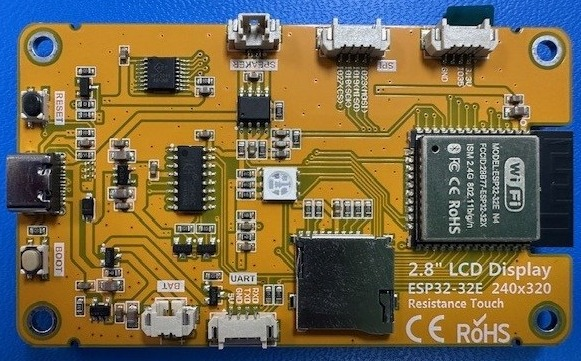
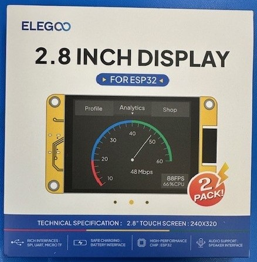
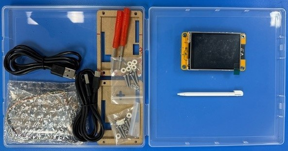

# The Cheap Yellow Display

*SHACK PROJECTS · EXTENDED EDITION*

A $15 shack gadget: what it is, what to buy, and how to turn it into a HamClock-style dashboard

**By Ed Barnes · November 3, 2026**

*The back of the author's Elegoo board: ESP32-WROOM-32E module (right), microSD slot (bottom center), battery and UART connectors (bottom), RESET and BOOT buttons beside the USB-C port (left), and speaker and SPI connectors (top). Photo by Ed Barnes, WA6ED.*

### At a Glance

| Cost | Setup | You need | Power | Best firmware |
|---|---|---|---|---|
| About $14 per board (Elegoo 2-pack, $27.99) | About 10 minutes with a web flasher, no coding | Chrome or Edge, a USB data cable, your callsign and grid square | Under 1 W from 5 V USB | CYD Ham Dashboard by HenrysCat |

### Why a $15 board belongs in the shack

For about the price of a coax jumper, you can buy a Wi-Fi computer with a color touchscreen already attached. Hobbyists call it the Cheap Yellow Display, or CYD, after the yellow circuit board on the back.

For hams, that adds up to a small, low-power screen that can sit on the operating desk and show the things we check all day: UTC time, solar and band conditions, DX spots, satellite passes, and station status. No Raspberry Pi, no monitor, no SD card to corrupt.

This extended edition covers what the board is, which version to buy, how to load software without writing code, a survey of ham-friendly projects, and a step-by-step guide to turning one into a HamClock-style dashboard.

### What is the CYD?

The CYD is an ESP32 microcontroller, a 2.8-inch 240×320 color touchscreen, and a microSD slot on one board. The name comes from Brian Lough (witnessmenow), whose GitHub repository became the community hub for the original Sunton ESP32-2432S028R. This article uses the Elegoo 2.8-inch ESP32-32E display (model E32R28T), a close cousin with the same screen and touch wiring, tested by the author with the CYD Ham Dashboard.

| Feature | Elegoo 2.8-inch ESP32-32E (E32R28T) |
|---|---|
| Processor | ESP32-WROOM-32E module, dual-core 240 MHz, Wi-Fi and Bluetooth |
| Flash | 4 MB |
| Display | 2.8-inch, 240×320, TN panel, ILI9341 driver over SPI |
| Touch | Resistive, XPT2046 controller |
| Storage | microSD slot |
| USB | Single USB-C; enters download mode automatically |
| Battery | 3.7 V LiPo connector with onboard charger |
| Extras | RGB LED, speaker connector, SPI and serial connectors |
| Power | 5 V, about 0.65 W with the display on |
| Board size | 50 × 86 mm |
| Price | $27.99 for a 2-pack on Amazon (Nov 2, 2026) |

Source: [LCDWIKI E32R28T specification (PDF)](https://www.lcdwiki.com/res/E32R28T/E32R28T_E32N28T_Specification_V1.0.pdf); price checked by the author. LCDWIKI (Shenzhen QDtech) designs this board; Elegoo sells it under its own name, so you will see both names on spec sheets.

Two limits matter for shack projects. First, few GPIO pins are free; the SPI and serial connectors are the easiest way to add sensors. Second, the TN panel looks best head-on, so mount it facing the operating position.

Want a bigger screen? You may want to order the 4-inch version instead, for about $5 more per board. Its 480×320 display shows larger text and more DX and POTA spots, and the CYD Ham Dashboard flasher has a 4-inch (ST7796S) build. The author has not tested the 4-inch board, so check that the listing names the ST7796S driver.

### How it compares with the original CYD

The Elegoo board and the original Sunton ESP32-2432S028R use the same screen, the same touch controller, and the same pins for both, so CYD firmware built for the ILI9341 panel runs on either. The differences are in the extras.

| Feature | Classic CYD (ESP32-2432S028R) | ESP32-32E (E32R28T) |
|---|---|---|
| Module | ESP32-WROOM-32 | ESP32-WROOM-32E, 4 MB flash |
| Display | 2.8" ILI9341, SPI on GPIO 14/13/12, CS 15, DC 2 | Same panel and same pins |
| Backlight | GPIO 21 | GPIO 21 |
| Touch | XPT2046 on GPIO 25/32/39, CS 33, IRQ 36 | Same controller and same pins |
| USB | Micro-USB, or micro-USB plus USB-C on later boards | Single USB-C with automatic download mode |
| Battery | None | 3.7 V LiPo connector with onboard charger |
| Light sensor | LDR on GPIO 34 | None; GPIO 34 reads battery voltage |
| RGB LED (red) | GPIO 4 | GPIO 22; GPIO 4 enables the audio amplifier |
| Extra connectors | Extended IO headers | SPI peripheral, serial, and IO35 input connectors |
| Power | About 0.6–0.9 W | 0.65 W display-only (130 mA at 5 V) |

Sources: [LCDWIKI E32R28T specification (PDF)](https://www.lcdwiki.com/res/E32R28T/E32R28T_E32N28T_Specification_V1.0.pdf), [atomic14 CYD page](https://www.atomic14.com/esp32/boards/esp32-2432s028r/), [Home Assistant community thread on the E32R28T](https://community.home-assistant.io/t/ili9xxx-spi-broken-in-2026-1-1-solved-e32r28t/978625).

What that means in practice:

Use the ILI9341 build of CYD firmware. The author's E32R28T runs HenrysCat's CYD Ham Dashboard with this build. Newer boards marked E32R28T-1 use an ST7789 panel and need the ST7789 build.

Expect small differences. Features tied to the light sensor or the red LED may not behave the same, because those pins do different jobs on this board.

The battery connector is a bonus for field use. A small 3.7 V LiPo turns the dashboard into a portable POTA or Field Day display.

Flashing is simpler. The USB-C port enters download mode on its own, so you rarely need the BOOT button.

Buy by model number. The author's board is an Elegoo, sold on Amazon as a 2-pack. Search for "Elegoo ESP32 2.8", "E32R28T" or "2.8inch ESP32-32E" to get this board, or "ESP32-2432S028R" for the classic.

### Where to buy and what to pay

Buy the Elegoo ESP32-32E (E32R28T) 2.8-inch display on Amazon: $27.99 for a 2-pack, about $14 each, as of Nov 2, 2026. It is the board the author tested with the CYD Ham Dashboard, and it arrives in 1–3 days with easy returns. Search Amazon for "Elegoo ESP32 2.8" or "E32R28T" to find it. Price checked by the author; Amazon prices change often.

*The Elegoo 2-pack as sold on Amazon. Photo by Ed Barnes, WA6ED.*

*What's in the box: the display, acrylic case panels with mounting screws and standoffs, two small screwdrivers, USB cables, connector leads, and a touch stylus. Photo by Ed Barnes, WA6ED.*

For a bigger screen, you may want to order the 4-inch version for about $5 more per board; see the note under "What is the CYD?" before you buy.

A club group buy works well here: a 2-pack or 5-pack lowers the per-board cost, and having a few identical boards makes a build night much easier to support.

### Getting started: four ways in

Most hams should start with a web flasher: no code, no toolchain, about five minutes. The other three paths are there when you want to customize.

| Path | Skill needed | What you do | Good for |
|---|---|---|---|
| Web flasher | None | Plug in USB, open a web page in Chrome or Edge, click Install | Ready-made dashboards and tools |
| Arduino IDE / PlatformIO | Some C++ | Install ESP32 board support plus the TFT_eSPI and XPT2046 libraries, then edit and upload sketches | Custom displays, learning |
| ESPHome | YAML config files | Describe the screen and sensors in a config file; pairs with Home Assistant | Shack monitoring and automation |
| MicroPython | Python | Flash MicroPython, then write scripts | Quick experiments |

A few things trip up first-timers:

Use a data USB cable, not a charge-only one. If the computer does not see a new serial port, swap the cable first.

The board uses a USB-to-serial chip (often a CH340). Windows and macOS usually have the driver; if not, install the CH340 driver from the chip maker.

Web flashers use the Web Serial feature, which works in Chrome and Edge on a desktop but not in Firefox or Safari.

If flashing stalls at "Connecting...", hold the BOOT button on the board while it starts, then release.

For the Arduino path, [Random Nerd Tutorials](https://randomnerdtutorials.com/cheap-yellow-display-esp32-2432s028r/) and the [witnessmenow repository](https://github.com/witnessmenow/ESP32-Cheap-Yellow-Display) have tested example sketches.

### Ham radio projects for the CYD

Several open-source projects turn a CYD into a shack appliance with nothing more than a web flasher. The table below lists the ones most useful to a radio club, starting with the closest thing to HamClock.

| Project | What it shows | Install | Link |
|---|---|---|---|
| CYD Ham Dashboard (HenrysCat) | Seven pages: UTC/local clock, HF propagation, VHF conditions, greyline map, PSKReporter map, DX cluster spots, POTA spots | Web flasher or PlatformIO | [GitHub](https://github.com/HenrysCat/esp32-cyd-ham-dashboard) |
| cyd-dashboard (Matt Housley) | ISS tracker, PSKReporter, FT8/DX/POTA/SOTA spots, HF propagation, weather and news | PlatformIO | [Trendshift listing](https://trendshift.io/repositories/73440) |
| 9M2PJU ESP32 DX Cluster Client | Live telnet DX cluster spots on many ESP32 screens | Web flasher | [hamradio.my](https://hamradio.my/9m2pju-esp32-dx-cluster-client/) |
| Overhead (JamesDavid) | Satellites overhead, rocket launches, ADS-B aircraft, space weather | Web flasher | [Trendshift listing](https://trendshift.io/repositories/73440) |
| CYD Weather Dashboard (HenrysCat) | 5-day forecast, hourly timeline, sun and moon, alerts | Web flasher | [Trendshift listing](https://trendshift.io/repositories/105694) |
| ESPHome on the CYD | Any sensor you wire up: shack temperature, power supply voltage, rotator heading, via Home Assistant | YAML config | [ESPHome examples](https://github.com/witnessmenow/ESP32-Cheap-Yellow-Display) |

Ideas for club build nights that go beyond ready-made firmware:

A net control timer and check-in counter, with the touchscreen as the start, stop and tally buttons.

A repeater status board that shows the club repeater's ID schedule, linked status, and upcoming nets.

A field-day band and score display, fed from the logging network.

A shack sensor panel for temperature, humidity and supply voltage, using I2C sensors on the free pins.

The CYD also shows up in Wi-Fi security tools such as ESP32 Marauder and Bruce. Those are not ham projects, so steer new members to the radio dashboards above.

### HamClock and the CYD

The original HamClock does not run on a CYD; it needs a Linux computer such as a Raspberry Pi. What runs on the CYD is the CYD Ham Dashboard, an independent project inspired by HamClock's look and purpose.

#### A short history

Elwood Downey, WB0OEW, introduced HamClock in an October 2017 QST article. It became one of the most familiar screens in ham shacks: space weather, propagation, DX spots and satellite passes on one kiosk display. HamClock was split into an open-source client and a closed backend server that supplied its data, which is why its future came into question in 2026.

| Date | Event |
|---|---|
| Aug 2026 | CYD Ham Dashboard by HenrysCat gains wide notice as a HamClock-inspired firmware for the CYD |
| June 2026 | Original Clear Sky Institute backend stops serving data; HamClocks must point to a community backend |
| Feb 2026 | hamclock.com (closed source) and the Open HamClock Backend, OHB (open source, led by Brian Wilkins KO4AQF), offer replacement servers; Inovato and N0LSR Design endorse OHB for their appliances |
| Jan 29, 2026 | WB0OEW becomes a Silent Key; the HamClock site announces version 4.22 is the last release |
| Oct 2017 | HamClock introduced in QST |

Sources: [ARNewsline](https://www.arnewsline.org/news-text/2026/1/30/silent-key-elwood-downey-wboew-creator-of-hamclock), [Amateur Radio Daily](https://daily.hamweekly.com/2026/01/hamclock-creator-elwood-downey-wb0oew-silent-key-hamclock-to-shut-down/), [Open HamClock on GitHub](https://github.com/openhamclock), [Amateur Radio Daily on OHB](https://daily.hamweekly.com/2026/02/inovato-n0lsr-designs-endorse-open-hamclock-backend-public-server/), [hamclock.com](https://hamclock.com/).

#### If you already run HamClock on a Pi

Your HamClock needs a new backend server. Point it to either [hamclock.com](https://hamclock.com/) or the [Open HamClock Backend](https://ohb.works/); both are free. The Open HamClock organization on GitHub also maintains the client and pre-built Raspberry Pi images.

#### What the CYD Ham Dashboard gives you

The CYD Ham Dashboard is open-source C++ firmware (GPL-3.0) that runs entirely on the ESP32. It needs no Pi, no SD card, and no HamClock backend, because it pulls data directly from public sources.

| Page | Shows | Data source |
|---|---|---|
| Clock | UTC and local time, Wi-Fi status, IP address | NTP time servers |
| HF propagation | SFI, sunspot number, A and K index, band ratings 80–10 m | N0NBH HamQSL |
| VHF conditions | Aurora, Sporadic-E on 6/4/2 m, flare alerts | N0NBH HamQSL |
| Greyline map | Day/night terminator, sunrise and sunset, your QTH | Calculated on the board |
| PSKReporter map | Where your signal is being heard | PSKReporter |
| DX cluster | Live spots via telnet or web feed | Your chosen DX cluster |
| POTA spots | Activators, optionally filtered by distance | POTA |

Sources: [hamradio.my review (9M2PJU)](https://hamradio.my/esp32-cyd-ham-dashboard-hamclock-touchscreen/), [Open Source For You](https://www.opensourceforu.com/2026/09/esp32-cyd-runs-ham-radio-dashboard/).

It supports the 2.8-inch CYD with either display driver and a 4-inch 480×320 variant. Tap the left or right side of the screen to change pages. It draws under 1 W, versus roughly 5–15 W for a Pi and monitor.

What it does not do: VOACAP propagation maps, satellite tracking, or the dense multi-pane layout of the full HamClock. On a 2.8-inch screen you see one page at a time.

### Step by step: flashing the CYD Ham Dashboard

The whole job takes about ten minutes and needs only a computer with Chrome or Edge, a USB data cable, your callsign, and your Maidenhead grid square.

1. Open the flasher. In Chrome or Edge on a desktop computer, go to [henryscat.github.io/esp32-cyd-ham-dashboard](https://henryscat.github.io/esp32-cyd-ham-dashboard/). The [HenrysCat flasher index](https://henryscat.github.io/) lists the author's other CYD firmware too.
2. Pick your board. Choose ILI9341 for the Elegoo 2.8-inch board and the original ESP32-2432S028R. If the image comes up mirrored, keep this build and turn on Mirror display in the settings page (step 8). Choose ST7789 only if the ILI9341 build leaves the screen blank or garbled; newer E32R28T-1 boards use an ST7789 panel. Choose ST7796S for the 4-inch 480×320 board.
3. Connect and install. Plug the CYD into the computer, click the install button, and pick the new serial port (often labeled CH340 or CP2102).
4. Erase on first install. When asked, tick Erase device for a first install. On later upgrades, leave it unticked to keep your callsign, locator and Wi-Fi settings.
5. Join the setup hotspot. After the board reboots, it starts its own Wi-Fi setup network. Connect a phone to it; a setup page should open on its own (if not, browse to 192.168.4.1).
6. Enter your details. Fill in your home Wi-Fi name and password, callsign, 6-character grid square, and time zone, then save.
7. Let it populate. The board joins your network, sets its clock, and fills in each page over the next minute or two. Tap the right or left edge of the screen to move between pages.
8. Fine-tune from a browser. Any computer on your network can open the settings page at the address shown on the clock page (the 9M2PJU review gives cyd-ham.local; the author found the board by its IP address instead, as noted below). There you can change brightness, the DX cluster server, the POTA distance filter, and color or rotation fixes.

Notes from testing the Elegoo board:

The image came up mirrored. The fix is in the dashboard's settings page: open it and turn on Mirror display.

Finding the IP address. If the board's name does not resolve in your browser (common on Windows), use a free network scanner such as Advanced IP Scanner to find the board's IP address, then type that address into the browser. Your router's list of connected devices works too.

Per the 9M2PJU review, holding the BOOT button for about five seconds while the dashboard runs resets it to factory settings. The author has not tested this on the Elegoo board.

Flasher details are from the [official flasher page](https://henryscat.github.io/esp32-cyd-ham-dashboard/); setup and reset details are from the [9M2PJU review](https://hamradio.my/esp32-cyd-ham-dashboard-hamclock-touchscreen/) and [Open Source For You](https://www.opensourceforu.com/2026/09/esp32-cyd-runs-ham-radio-dashboard/). Check the project's [GitHub README](https://github.com/HenrysCat/esp32-cyd-ham-dashboard) for the current hotspot name and password before a club build night.

### Enclosures, power and RF in the shack

Put the board in a case, feed it clean 5 V, and treat it like any other digital gadget near your receiver.

#### Enclosures

A bare board on a desk full of coax and tools invites a short. The Elegoo kit includes an acrylic case with mounting screws, which is enough for most desks. For an angled stand or a sturdier field case, free 3D-printable designs are plentiful; two good starting points are an [angled desktop enclosure with a stylus holder](https://www.printables.com/model/769863-esp32-cheap-yellow-display-cyd-enclosure-with-pen-) and a [compact snap-fit case](https://www.printables.com/model/1285303-esp32-cheap-yellow-display-cyd-case-for-bruce-mara) for portable use. If no one in the club owns a printer, a small project box with a window cut for the screen works fine. Tilt the display toward your eyes, since the TN panel dims when viewed off-axis.

#### Power

The CYD runs on 5 V USB and draws roughly 120–180 mA, or under 1 W [(9M2PJU review)](https://hamradio.my/esp32-cyd-ham-dashboard-hamclock-touchscreen/). Options include a USB port on a computer or hub, a phone charger, a power bank for field use, or a 12 V-to-5 V converter off the station supply. Use a supply that delivers a steady 5 V; marginal supplies cause random resets when Wi-Fi transmits.

#### RF considerations

Receive noise. Cheap USB chargers and buck converters can radiate HF hash. If you hear new noise, try a linear supply or a better charger, and add clip-on ferrite chokes on the USB cable near both ends.

The board's own emissions. The ESP32's 2.4 GHz Wi-Fi sits close to the 13 cm amateur band; keep the CYD away from 2.4 GHz gear and its antennas. The digital circuitry can also produce weak spurs on VHF/UHF; moving it a meter from the rig usually solves that.

Your transmitter. Strong RF in the shack can reset the board or upset the touchscreen. Good station grounding, chokes on the USB lead, and keeping the CYD away from the antenna feed point all help.

Wi-Fi coverage. The board needs your shack Wi-Fi. If the signal is weak, move it closer to the access point or add a small extender; dropped connections show up as stale data.

### Troubleshooting

Most CYD problems come down to the cable, the board revision, or Wi-Fi. Work down this table before assuming the board is bad.

| Symptom | Likely cause | Fix |
|---|---|---|
| Computer does not see the board | Charge-only cable or missing driver | Swap to a known data cable; install the CH340 driver |
| Flasher has no Install button or port list | Unsupported browser | Use Chrome or Edge on a desktop computer |
| Flashing stalls at "Connecting" | Board not entering download mode | Hold BOOT while clicking Install, release when it starts |
| Screen blank or white after flashing | Wrong display driver build | Reflash with the other driver option (ILI9341 vs ST7789) |
| Colors wrong or image mirrored | Panel variant differences | Turn on Mirror display in the settings page (needed on the author's Elegoo board); color and rotation fixes are there too |
| Touch hits the wrong spot | Resistive touch needs calibration or axis flip | Run the firmware's calibration or flip touch axes in settings |
| Random reboots | Weak power supply or RF pickup | Better 5 V supply; ferrite chokes; move away from antennas |
| Pages show old or no data | Wi-Fi drop or data source down | Check signal strength on the clock page; try a manual refresh |
| Not sure what board you have | Unlabeled clone | Flash the [HenrysCat CYD Diagnostic Tool](https://henryscat.github.io/ESP32-2432S028-CYD-Diagnostic-Tool/) to identify and test it |

When all else fails, the [witnessmenow repository](https://github.com/witnessmenow/ESP32-Cheap-Yellow-Display) and its Discord community are friendly to beginners.

### Sources and further reading

All pages below were checked on 2026-11-02. Vendor prices change quickly; confirm them before printing.

#### Hardware

- [atomic14: Cheap Yellow Display family guide](https://www.atomic14.com/esp32/boards/cheap-yellow-display/)
- [atomic14: ESP32-2432S028R board page](https://www.atomic14.com/esp32/boards/esp32-2432s028r/)
- [witnessmenow/ESP32-Cheap-Yellow-Display (community hub)](https://github.com/witnessmenow/ESP32-Cheap-Yellow-Display)
- [Random Nerd Tutorials: Getting started with the CYD](https://randomnerdtutorials.com/cheap-yellow-display-esp32-2432s028r/)
- ESP32-32E board (E32R28T)
- [LCDWIKI: 2.8inch ESP32-32E (E32R28T) Specification V1.0 (PDF)](https://www.lcdwiki.com/res/E32R28T/E32R28T_E32N28T_Specification_V1.0.pdf); the [E32R28T-1 revision page](https://www.lcdwiki.com/2.8inch_ESP32-32E-7789) covers the newer ST7789 version
- [Home Assistant community: E32R28T display setup thread](https://community.home-assistant.io/t/ili9xxx-spi-broken-in-2026-1-1-solved-e32r28t/978625)

#### CYD Ham Dashboard and other firmware

- [CYD Ham Dashboard on GitHub (HenrysCat)](https://github.com/HenrysCat/esp32-cyd-ham-dashboard)
- [CYD Ham Dashboard web flasher](https://henryscat.github.io/esp32-cyd-ham-dashboard/)
- [HenrysCat flasher index (diagnostic tool, weather dashboard)](https://henryscat.github.io/)
- [9M2PJU review of the CYD Ham Dashboard (hamradio.my)](https://hamradio.my/esp32-cyd-ham-dashboard-hamclock-touchscreen/)
- [Open Source For You: ESP32 CYD runs ham radio dashboard](https://www.opensourceforu.com/2026/09/esp32-cyd-runs-ham-radio-dashboard/)
- [Matt Housley cyd-dashboard (Trendshift listing)](https://trendshift.io/repositories/73440)
- [9M2PJU ESP32 DX Cluster Client](https://hamradio.my/9m2pju-esp32-dx-cluster-client/)

#### HamClock history and backends

- [ARNewsline: Silent Key Elwood Downey, WB0OEW](https://www.arnewsline.org/news-text/2026/1/30/silent-key-elwood-downey-wboew-creator-of-hamclock)
- [Amateur Radio Daily: HamClock project to sunset June 2026](https://daily.hamweekly.com/2026/01/hamclock-creator-elwood-downey-wb0oew-silent-key-hamclock-to-shut-down/)
- [Amateur Radio Daily: Inovato, N0LSR Design endorse OHB](https://daily.hamweekly.com/2026/02/inovato-n0lsr-designs-endorse-open-hamclock-backend-public-server/)
- [Open HamClock on GitHub](https://github.com/openhamclock)
- [hamclock.com community backend](https://hamclock.com/)

#### Enclosures

- [Printables: CYD enclosure with pen holder](https://www.printables.com/model/769863-esp32-cheap-yellow-display-cyd-enclosure-with-pen-)
- [Printables: compact CYD case](https://www.printables.com/model/1285303-esp32-cheap-yellow-display-cyd-case-for-bruce-mara)

## Images and Attachments

Three photographs from the PDF, in order. The PDF credit line is "Photo: author." The newsletter credit reads "Photo by Ed Barnes, WA6ED" because the article and the submitting email are his. Ray should confirm.

| Filename | Caption | Photographer | Permission confirmed? |
|---|---|---|---|
| feature-cyd-board-back-wa6ed-01.jpeg | Back of the Elegoo board, parts called out. | Ed Barnes, WA6ED | Submitted with the article |
| feature-cyd-elegoo-box-wa6ed-02.jpeg | Elegoo 2-pack retail box. | Ed Barnes, WA6ED | Submitted with the article |
| feature-cyd-kit-contents-wa6ed-03.jpeg | Kit contents in the box. | Ed Barnes, WA6ED | Submitted with the article |

## Editor Notes

- This is the November 3, 2026 Extended Edition (10 pages). It replaces the earlier CYD article. The Nov 1 file is not in the inbox and is not in this issue. Ed's email said only "Extended version, Ed." That sentence is not part of the article.
- Text, tables, photos, captions, and link targets were taken from the PDF. Subsection headings are his. Order is his, including the HamClock history table, which runs newest first. Nothing was shortened.
- "Photo: author." was expanded to "Photo by Ed Barnes, WA6ED." Byline left as "By Ed Barnes · November 3, 2026" with no callsign added.
- "ESP32-32E board (E32R28T)" in Sources has no URL in the PDF. Left as a plain line.
- **Link targets kept even where they look wrong. Not corrected:**
  - cyd-dashboard (Matt Housley) and Overhead (JamesDavid) both point at `https://trendshift.io/repositories/73440` in the PDF. Weather dashboard points at `repositories/105694`.
  - "ESPHome examples" points at `https://github.com/witnessmenow/ESP32-Cheap-Yellow-Display`, the same repository as the witnessmenow hub, not a separate ESPHome page.
  - The ARNewsline URL slug spells the call "wboew". The article text says WB0OEW. WB0OEW checks as Elwood C Downey, Extra. The URL was not edited.
  - Both Printables URLs are stored in the PDF already cut off (one ends in a hyphen, one ends in "mara"). They were not completed.
  - Brian Wilkins, KO4AQF, checks as a valid General-class license. N0LSR was not a personal call in this article (it is "N0LSR Design") and was not looked up as a person.
- Link check on 2026-11-08: the LCDWIKI PDF, atomic14 pages, Random Nerd Tutorials, witnessmenow, HenrysCat GitHub and flasher pages, both Trendshift URLs, both hamradio.my pages, Open Source For You, ARNewsline, both Amateur Radio Daily pages, openhamclock, hamclock.com, ohb.works, the diagnostic tool, and the E32R28T-1 page returned HTTP 200. The Home Assistant thread and both Printables URLs returned HTTP 403 to this checker. That is often a bot block. They were not rewritten, and they were not dropped.
- Prices ($27.99, about $14, about $5 more, under 1 W, 120–180 mA) are the author's, dated by him Nov 2, 2026. Not changed. His own line says to confirm vendor prices before printing.
- QST reprint: he cites an October 2017 QST article by WB0OEW. This is a citation, not a reprint of QST text. No QST prose was copied in.
- GPIO pin claims, driver names, and the HamClock timeline are his technical account. They were not independently re-tested. Flagged for Ray rather than edited.
