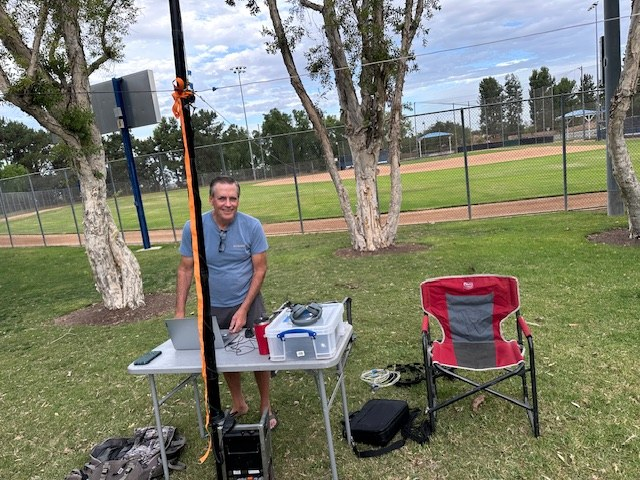
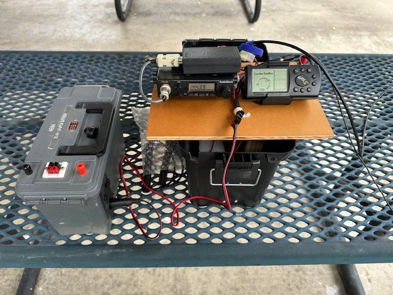
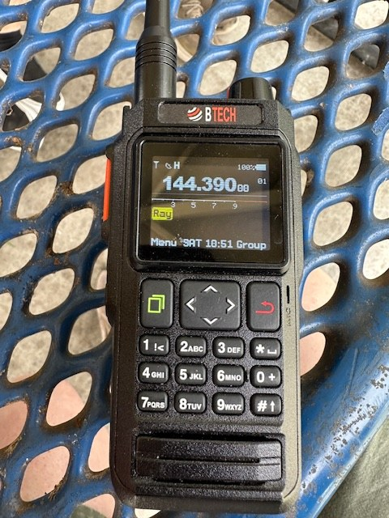
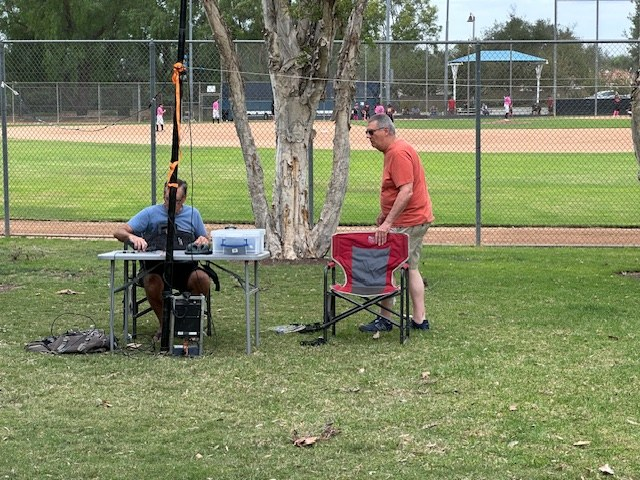
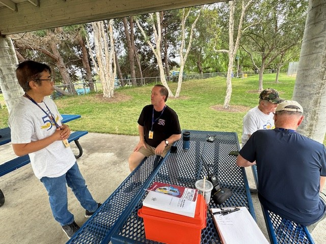

# SOARA Saturday Report

### October 17, 2026 Recap

Hi all,

Thanks to everyone who came out to Elmer Saturday on October 17. We had a good turnout and plenty of radio talk.

Attendees: Ed WA6ED, Greg WE4BY, Greg N6PM, Ray K6NOV, Ray AE6H, Jimmy KK6TTL, Claude W6CAG, Patti AD6OH

Thank you, Greg! Greg WE4BY brought the coffee and donuts.

### Demos

*Greg WE4BY set up a portable HF station in the park. Photo by Ed Barnes, WA6ED.*

*Ray AE6H set up an older APRS station: a mobile rig on 144.390 MHz paired with a vintage Garmin GPS, all running off a battery box. Photo by Ed Barnes, WA6ED.*

*We also looked at the BTECH UV-Pro, a waterproof (IP67) handheld with built-in APRS, GPS and Bluetooth. It runs about $167 on Amazon and is shown here tuned to 144.390 MHz. Photo by Ed Barnes, WA6ED.*

### Around the Room

*Greg WE4BY and Greg N6PM talking radio at the HF station. Photo by Ed Barnes, WA6ED.*

*Jimmy KK6TTL, Ray K6NOV, Claude W6CAG and Ray AE6H talking radio. Photo by Ed Barnes, WA6ED.*

### Donut Fund

<ul style="break-inside: avoid">
<li>Starting balance: $55</li>
<li>Paid out: $20 to Greg WE4BY for donuts</li>
<li>Collected: $12</li>
<li>Balance carried forward: $47</li>
</ul>

### Next Meeting: Saturday, November 21, 2026

- Time: 9:00 AM to noon
- Where: Murray Center
- Theme: Kit building

Bring a kit you'd like to build, and please RSVP by Wednesday, November 18 if you plan to build so I know whether to bring my soldering gear. Other demos are welcome too.

73,

Ed, WA6ED

## Images and Attachments

Five photographs extracted from Ed's PDF, in the order they appear there. Captions are Ed's own sentences. The PDF said nothing more than the caption under each photo, so "Photo by Ed Barnes, WA6ED" was added from the PDF metadata (author: Ed WA6ED) and the submission. Ray should confirm the credit.

| Filename | Caption | Photographer | Permission confirmed? |
|---|---|---|---|
| soara-saturday-hf-station-we4by-wa6ed-01.jpeg | Greg WE4BY set up a portable HF station in the park. | Ed Barnes, WA6ED | Submitted by Ed with the report |
| soara-saturday-aprs-station-ae6h-wa6ed-02.jpeg | Ray AE6H's older APRS station, Garmin GPS, battery box. | Ed Barnes, WA6ED | Submitted by Ed with the report |
| soara-saturday-btech-uv-pro-wa6ed-03.jpeg | BTECH UV-Pro on 144.390 MHz. | Ed Barnes, WA6ED | Submitted by Ed with the report |
| soara-saturday-gregs-hf-wa6ed-04.jpeg | Greg WE4BY and Greg N6PM at the HF station. | Ed Barnes, WA6ED | Submitted by Ed with the report |
| soara-saturday-group-talk-wa6ed-05.jpeg | Jimmy KK6TTL, Ray K6NOV, Claude W6CAG and Ray AE6H. | Ed Barnes, WA6ED | Submitted by Ed with the report |

## Editor Notes

- Full text of `SOARA_Elmer_Saturday_2026-10-17.pdf` (3 pages). The email body was only "Sent from my iPad. Please disregard typos." and is not printed. No sentences were cut.
- PDF title "SOARA Elmer Saturday" is carried by the section heading plus "October 17, 2026 Recap."
- Donut figures kept: start $55, paid $20, collected $12, balance $47. $55 matches the balance Ed reported for October in the October issue.
- Next SOARA Saturday in his report: Saturday, November 21, 2026, 9:00 AM to noon, Murray Center, theme Kit building, RSVP by Wednesday, November 18 for anyone who will build. The soara.org Elmer Saturday page lists the same date, place, and "Kit building & how to solder." December 19 is the following third Saturday and is on that same page; Ed does not announce a December theme here, so none was added.
- Callsigns checked at callook.info on 2026-11-08, all valid: WA6ED Edwin D Barnes, WE4BY Gregory A Unruh, N6PM Greg L De Hoogh, K6NOV Raymond J Frericks Jr, AE6H Raymond B Hutchinson, W6CAG Claude A Goldsmith, AD6OH Patricia D Peschel, KK6TTL Zhiming Huang.
- **Name flag, not changed.** Ed writes "Jimmy KK6TTL." The FCC licensee name on KK6TTL is Zhiming Huang. Printed as Ed wrote it. Ray or Ed should confirm Jimmy is the name to use.
- Patti and Greg are the names Ed used; legal first names were not substituted.
- The $167 Amazon price for the BTECH UV-Pro is Ed's figure. Not re-checked and not changed.
