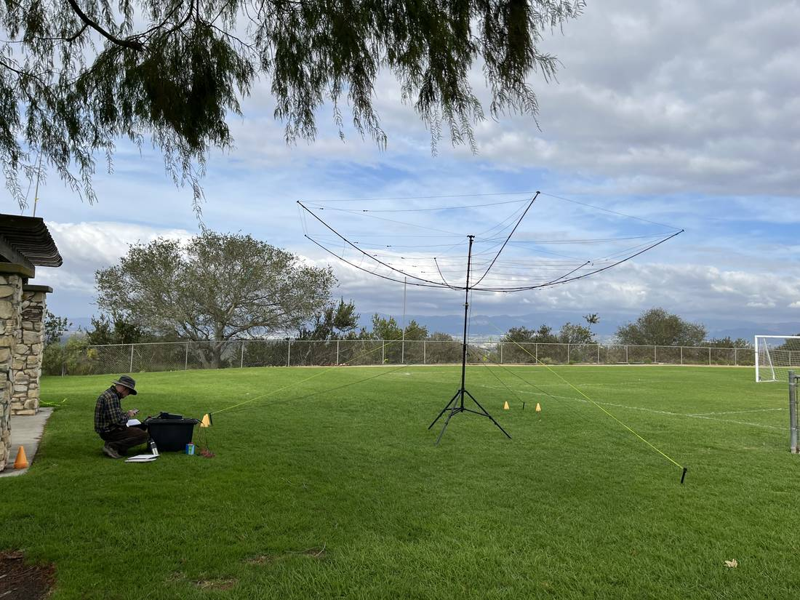
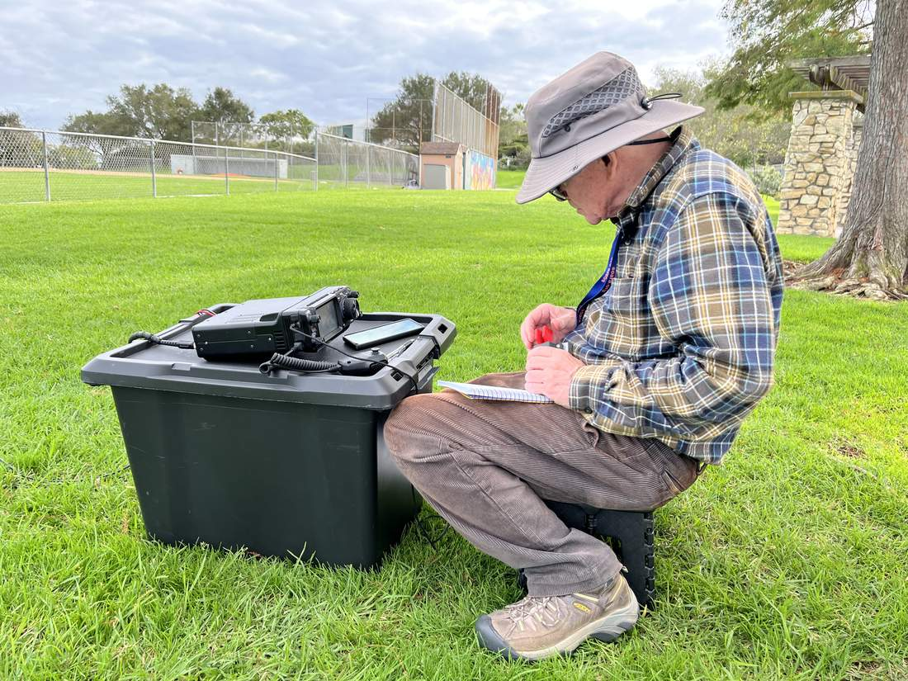
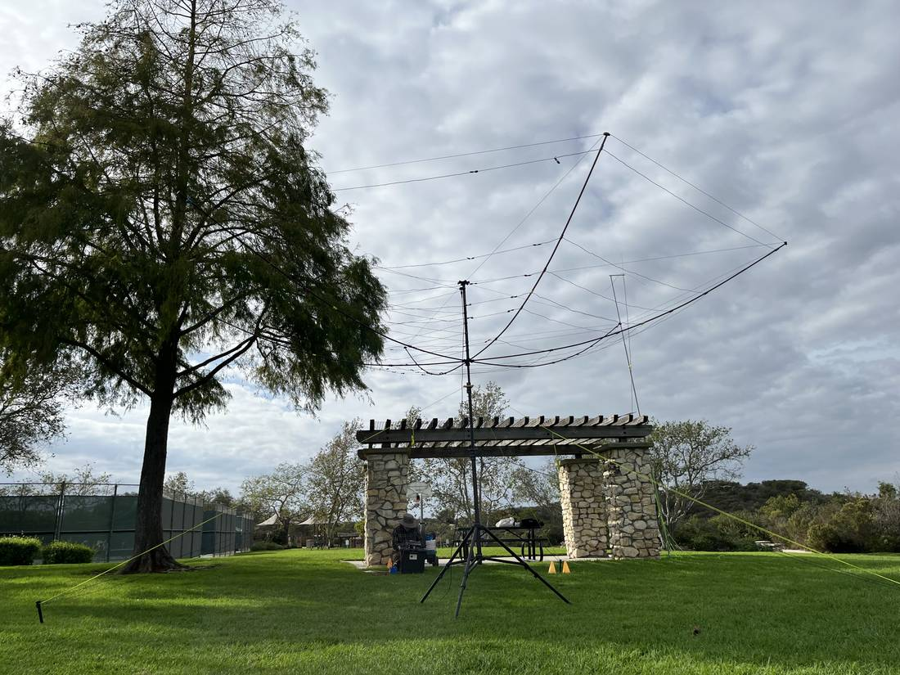
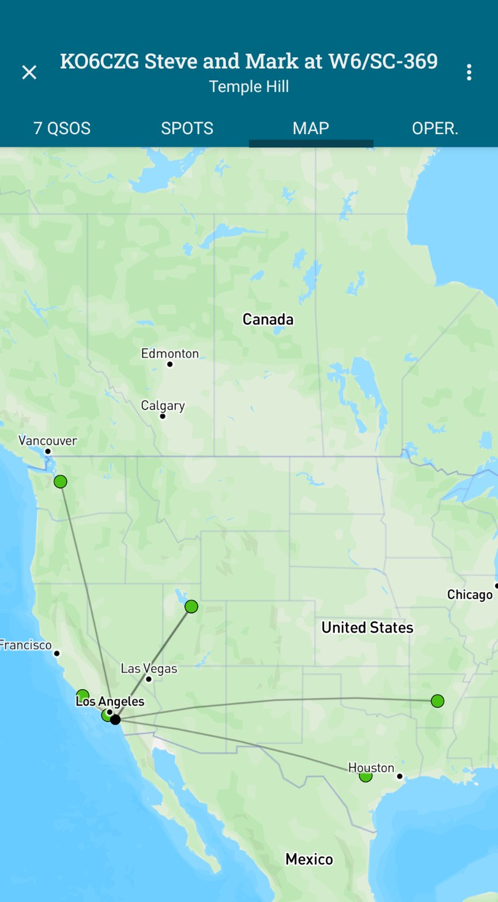

# Temple Hill Activated

**From a report by Mark Wisniewski, KO6CZG, and Steve Johnson, KN6HI**

On Thursday, October 29, SOARA members Steve Johnson, KN6HI, and Mark Wisniewski, KO6CZG, took a hexbeam and 100 watts up to Temple Hill and activated the summit for Summits on the Air (SOTA). Temple Hill, W6/SC-369, stands just over 1,000 feet in the Laguna hills and is familiar ground for the club: SOARA's Temple Hill repeaters are there as well.

Putting the hexbeam up took a while, Mark wrote, but once it was in the air it worked like a charm. Their SOTA log shows seven contacts in about twenty minutes, all on 20-meter CW, with 599 reports both ways. The beam found stations in Washington, Texas, Utah, Arkansas, and California.

One contact stood out. Steve was working a station in Alta Loma on CW when the other operator asked him to switch to SSB, and passed the new frequency in Morse. "We felt the day was a success," Mark wrote.

*The hexbeam on Temple Hill, W6/SC-369, on October 29. Photo by Steve Johnson, KN6HI.*

*Mark, KO6CZG, logs contacts at the portable station. Photo by Steve Johnson, KN6HI.*

*The hexbeam and park pavilion on Temple Hill. Photo by Steve Johnson, KN6HI.*

*The seven contacts from Temple Hill. Screenshot by Mark Wisniewski, KO6CZG, from his SOTA logging map.*

## Images and Attachments

Four photographs selected from the source emails. Steve sent five iPhone photos; Mark sent three SOTA app screenshots. The unused photos (Steve's IMG_5402 and IMG_5405, and Mark's QSO-list and official SOTA-results screenshots) were not filed in `assets/`.

| Filename | Caption | Photographer | Permission confirmed? |
|---|---|---|---|
| feature-temple-hill-hexbeam-kn6hi-01.jpeg | The hexbeam on Temple Hill, W6/SC-369, on October 29. | Steve Johnson, KN6HI | Sent by Steve for the club, 2026-10-30 |
| feature-temple-hill-mark-logging-kn6hi-02.jpeg | Mark, KO6CZG, logs contacts at the portable station. | Steve Johnson, KN6HI | Sent by Steve for the club, 2026-10-30; Ray confirmed the operator is Mark, 2026-11-09 |
| feature-temple-hill-pavilion-kn6hi-03.jpeg | The hexbeam and park pavilion on Temple Hill. | Steve Johnson, KN6HI | Sent by Steve for the club, 2026-10-30 |
| feature-temple-hill-propagation-map-ko6czg-04.jpeg | The seven contacts from Temple Hill. | Mark Wisniewski, KO6CZG | Sent by Mark with the activation note, 2026-10-29 |

## Editor Notes

- This article was written by the editor from Mark's short email and Steve's photo follow-up; it is not a verbatim reprint. Ray approved the wording on 2026-11-09.
- Steve's callsign KN6HI is from his June 2024 Propagator article ("Mobile Mount Propagator Article 6/8/24 KN6HI").
- Activation date, the seven QSOs, 20-meter CW, 599 reports, and the states worked come from the SOTA log screenshots Mark sent and from the public SOTA database (W6/SC-369, 2026-10-29, callsign KO6CZG). Photo EXIF on Steve's pictures is 2026-10-29, about 3:02–3:04 PM PT.
- Mark's email said "Posted to SOTA, first time this year so got credit!" That line was left out of the article. The official SOTA entry for this activation is under KO6CZG and shows 0 points, because he had already activated Temple Hill on 2026-02-03 (SOTA awards the summit point once per calendar year). The October outing still qualifies as an activation (four or more QSOs).
- Mark wrote "Altaloma"; the article uses Alta Loma. The SSB contact is not in the seven-QSO CW log, so the other station is not named.
- Temple Hill elevation (just over 1,000 feet) is from the SOTA summit record (1,010 ft / 308 m).
- The map figure is cropped from Mark's phone screenshot to the title bar and the map, including all seven contact pins. Map data in the screenshot is from Mapbox.
